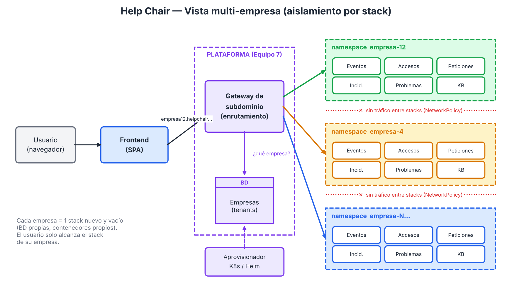
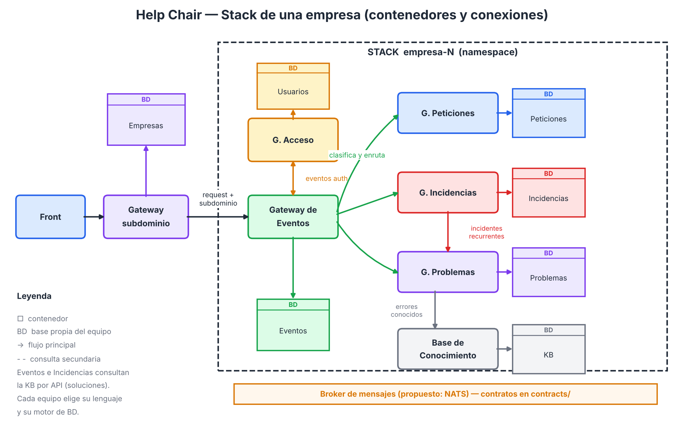

# Help Chair

[Versión en español → README.md](README.md)

> **Multi-tenant help desk** platform, 100 % aligned with **ITIL v4**, built as **microservices** and deployed as an **isolated stack per company**. All the code lives in this **monorepo**.

Academic-professional project developed at the **Centro de Enseñanza Técnica Industrial (CETI)**.

---

## 📌 What is Help Chair?

Help Chair is a help desk template that companies subscribe to as a service. Once a company signs up:

1. It is registered and gets its own **subdomain** (e.g. `company12.helpchair.example`).
2. The system creates a **new, empty stack** (dedicated containers and databases) just for that company.
3. The first user becomes the **stack administrator** and configures the help desk through an *onboarding* wizard (services, priorities, SLAs, departments, users and roles).
4. From then on the help desk works with events, requests, incidents and problems, with **no contact with other companies' stacks**.

## 🧭 Architecture at a glance





More detail in [`docs/ARCHITECTURE.md`](docs/ARCHITECTURE.md).

## 🗂️ Monorepo structure

```
help-chair/
├── services/
│   ├── events/        # Team 1 · Event Management
│   ├── access/        # Team 2 · Access Management
│   ├── requests/      # Team 3 · Request Management
│   ├── incidents/     # Team 4 · Incident Management
│   ├── problems/      # Team 5 · Problem Management
│   └── knowledge/     # Team 5 · Knowledge Base
├── frontend/          # Team 6 · Service Desk
├── platform/
│   ├── gateway/       # Team 7 · Subdomain gateway + companies DB
│   └── deploy/        # Team 7 · Kubernetes, Helm, docker-compose
├── contracts/         # APIs (OpenAPI) and inter-service messages
├── docs/              # Architecture, ITIL, decisions
├── scripts/           # Repository automation
└── .github/           # CODEOWNERS, templates, workflows
```

## 👥 Teams and folders

| # | Team | ITIL v4 practice | Folder |
|---|------|------------------|--------|
| 1 | Event Management | Monitoring and Event Management | `services/events` |
| 2 | Access Management | Service Request Mgmt + Information Security Mgmt | `services/access` |
| 3 | Request Management | Service Request Management | `services/requests` |
| 4 | Incident Management | Incident Management | `services/incidents` |
| 5 | Problem Management | Problem Management + Knowledge Management | `services/problems`, `services/knowledge` |
| 6 | Frontend | Service Desk | `frontend` |
| 7 | Platform | Technical enablement (gateway, tenants, K8s) | `platform/gateway`, `platform/deploy` |

> Each team **owns** its folder (via `CODEOWNERS`), its database and its language/framework. A monorepo is **not** a monolith: every service is still an independent container with its own DB. Teams coordinate **only through contracts** (`contracts/`).

## 📚 ITIL v4 as the guide

The design uses ITIL v4 vocabulary (**practices**, not processes). The full mapping between practices, services and teams is in [`docs/ITIL-MAPPING.md`](docs/ITIL-MAPPING.md).

## 🧱 Design principles

- **Full isolation per company:** one Kubernetes namespace per stack; no stack talks to another.
- **Database per service:** every service has its own database; nobody reads another team's DB.
- **Contracts first:** APIs (OpenAPI) and messages (broker) are defined and versioned in `contracts/`.
- **Controlled polyglot:** each team picks its language, but all must meet the *Minimum service contract* (below).
- **Independence inside the monorepo:** each folder has its own path-filtered CI, its own image and its own versioning.
- **Resource efficiency:** small images, declared CPU/RAM limits and hibernating idle stacks.

## ✅ Minimum service contract

Every service, whatever the language, must:

- Ship a `Dockerfile` and run as a **non-root** user.
- Expose `GET /health/live` and `GET /health/ready`.
- Be configured **only through environment variables** (no secrets in the repo; provide `.env.example`).
- Write **JSON logs** to stdout/stderr.
- Document its API with **OpenAPI** in `contracts/<service>/` and publish events as defined in `contracts/messages/`.
- Publish its image as `ghcr.io/help-chair/hc-<service>:<semver>`.
- Declare resource `requests`/`limits` in its deployment.
- Shut down gracefully (`SIGTERM`).
- Have its CI workflow **filtered to its own folder**.

## 🚀 Getting started

1. Read the [contributing guide](CONTRIBUTING.en.md) (branching, commits, PRs and monorepo rules).
2. Clone the repository and branch off `develop`:
   ```bash
   git clone https://github.com/help-chair/help-chair.git
   cd help-chair
   git switch develop && git switch -c feature/<area>/<n>-<description>
   ```
3. Work **only inside your team's folder**.
4. Bring up the local environment with `platform/deploy` *(under construction)*.

## 🗺️ Roadmap (high level)

- [ ] **Phase 0** — Repo, standards, initial contracts.
- [ ] **Phase 1** — Single-stack MVP: Events → Requests / Incidents / Problems, Access and KB.
- [ ] **Phase 2** — Subdomain gateway, company registry and automatic provisioning.
- [ ] **Phase 3** — Configurable onboarding, SLAs and notifications.
- [ ] **Phase 4** — Hardening: observability, resource optimisation, Change Enablement.

## 📄 License

To be defined. Until then, all rights reserved.

## 🏫 Institution

Centro de Enseñanza Técnica Industrial (CETI).
