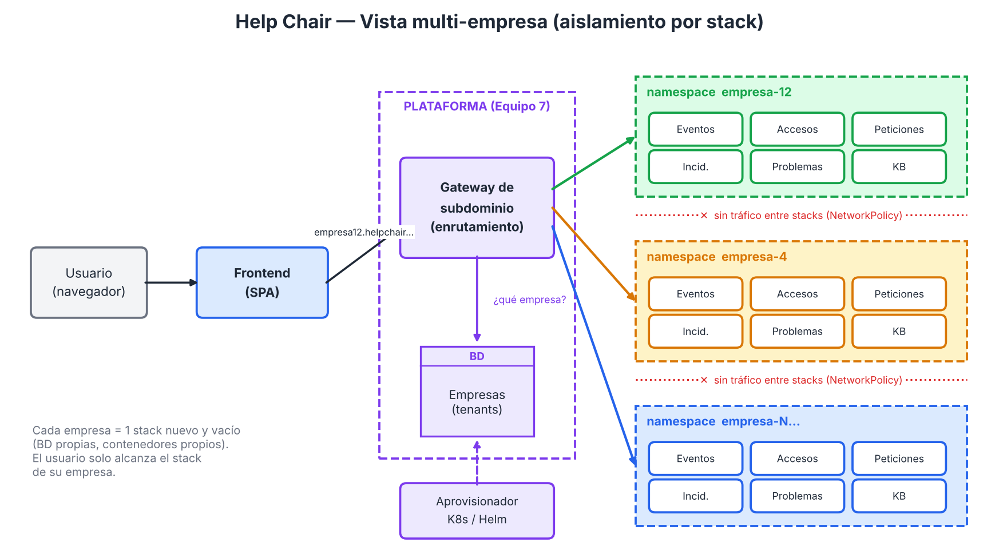
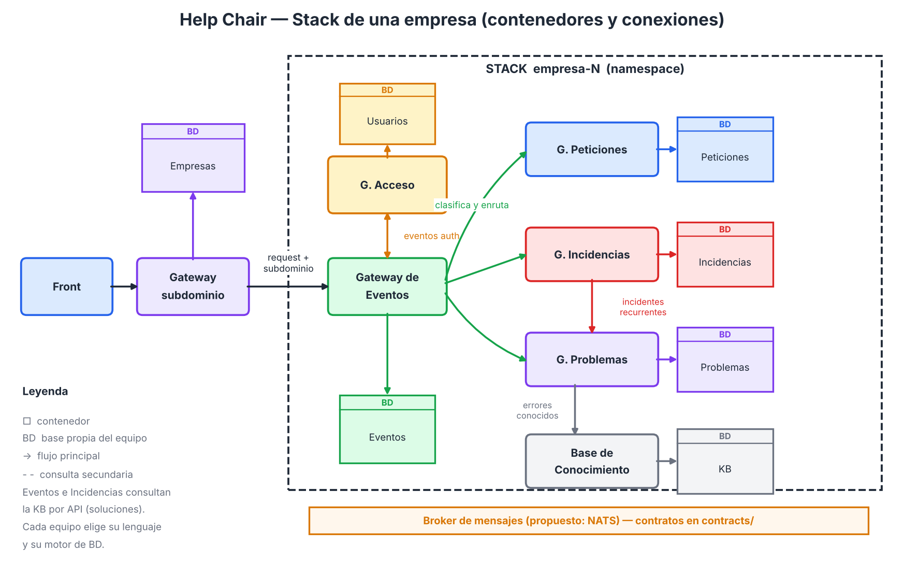
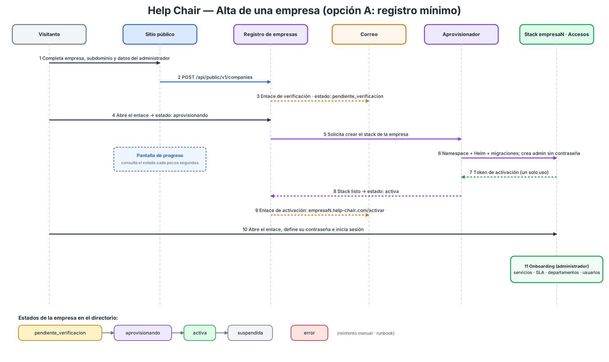

# Help Chair

[English version → README.en.md](README.en.md)

> Plataforma **help desk multiempresa** alineada al 100 % con **ITIL v4**, construida como **microservicios** y desplegada en un **stack aislado por empresa**. Todo el código vive en este **monorepo**.

Proyecto académico-profesional desarrollado en el **Centro de Enseñanza Técnica Industrial (CETI)**.

---

## 📌 ¿Qué es Help Chair?

Help Chair es una plantilla de help desk que una empresa contrata como servicio. El ciclo de vida es:

1. Una empresa llega al **sitio público** (`help-chair.com`), conoce el producto y pulsa **Registrar mi empresa**.
2. Completa un **registro mínimo** (empresa, subdominio y administrador), verifica su correo y recibe un **subdominio propio** (por ejemplo `empresa12.help-chair.com`).
3. El sistema crea un **stack nuevo y vacío** (contenedores y bases de datos propios) solo para esa empresa.
4. El administrador activa su cuenta, define su contraseña y configura su help desk con un asistente de *onboarding* (servicios, prioridades, SLA, departamentos, usuarios y roles).
5. A partir de ahí, el help desk opera sobre eventos, peticiones, incidentes y problemas, **sin ningún contacto con los stacks de otras empresas**.

> Más adelante se incorporará una licencia de pago; por ahora el registro es gratuito (campo `plan` reservado en el directorio).

## 🧭 Arquitectura en una imagen







Más detalle en [`docs/ARCHITECTURE.md`](docs/ARCHITECTURE.md) y, para el alta de empresas, en [`docs/REGISTRO-EMPRESA.md`](docs/REGISTRO-EMPRESA.md).

## 🗂️ Estructura del monorepo

```
help-chair/
├── services/
│   ├── events/        # Equipo 1 · Gestión de Eventos
│   ├── access/        # Equipo 2 · Gestión de Accesos
│   ├── requests/      # Equipo 3 · Gestión de Peticiones
│   ├── incidents/     # Equipo 4 · Gestión de Incidencias
│   ├── problems/      # Equipo 5 · Gestión de Problemas
│   └── knowledge/     # Equipo 5 · Base de Conocimiento
├── frontend/          # Equipo 6 · Sitio público + Service Desk (una sola SPA)
├── platform/
│   ├── gateway/       # Equipo 7 · Gateway de subdominio, registro de empresas + BD de empresas
│   └── deploy/        # Equipo 7 · Kubernetes, Helm, docker-compose
├── contracts/         # APIs (OpenAPI) y mensajes entre servicios
├── docs/              # Arquitectura, ITIL, decisiones
├── scripts/           # Automatización del repositorio
└── .github/           # CODEOWNERS, plantillas, workflows
```

## 👥 Equipos y carpetas

| # | Equipo | Práctica ITIL v4 | Carpeta |
|---|--------|------------------|---------|
| 1 | Gestión de Eventos | Monitoring and Event Management | `services/events` |
| 2 | Gestión de Accesos | Service Request Mgmt + Information Security Mgmt | `services/access` |
| 3 | Gestión de Peticiones | Service Request Management | `services/requests` |
| 4 | Gestión de Incidencias | Incident Management | `services/incidents` |
| 5 | Gestión de Problemas | Problem Management + Knowledge Management | `services/problems`, `services/knowledge` |
| 6 | Frontend | Service Desk + sitio público y registro | `frontend` |
| 7 | Plataforma | Habilitación técnica (gateway, registro de empresas, tenants, K8s) | `platform/gateway`, `platform/deploy` |

> Cada equipo es **dueño** de su carpeta (vía `CODEOWNERS`), de su base de datos y de su lenguaje/framework. Un monorepo **no** significa un monolito: cada servicio sigue siendo un contenedor independiente con su propia BD. La coordinación entre equipos se hace **solo mediante contratos** (`contracts/`).

## 📚 ITIL v4 como guía

El diseño usa el vocabulario de ITIL v4 (**prácticas**, no procesos). La correspondencia completa entre prácticas, servicios y equipos está en [`docs/ITIL-MAPPING.md`](docs/ITIL-MAPPING.md).

## 🧱 Principios de diseño

- **Aislamiento total por empresa:** un namespace de Kubernetes por stack; ningún stack se comunica con otro.
- **Database per service:** cada servicio tiene su propia base de datos; nadie lee la BD de otro equipo.
- **Contratos primero:** APIs (OpenAPI) y mensajes (broker) se definen y versionan en `contracts/`.
- **Independencia dentro del monorepo:** cada carpeta tiene su propio CI (filtrado por ruta), su propia imagen y su propio versionado.
- **Eficiencia de recursos:** imágenes pequeñas, límites de CPU/RAM declarados y stacks inactivos hibernables.

## ✅ Contrato mínimo de servicio

Todo servicio, sin importar el lenguaje, debe:

- Tener `Dockerfile` y ejecutarse como usuario **no root**.
- Exponer `GET /health/live` y `GET /health/ready`.
- Configurarse **solo por variables de entorno** (sin secretos en el repositorio; incluir `.env.example`).
- Escribir **logs en JSON** por stdout/stderr.
- Documentar su API con **OpenAPI** en `contracts/<servicio>/` y publicar sus eventos según `contracts/messages/`.
- Publicar su imagen como `ghcr.io/help-chair/hc-<servicio>:<semver>`.
- Declarar `requests`/`limits` de recursos en su despliegue.
- Cerrar con gracia (`SIGTERM`).
- Tener su workflow de CI **filtrado por su carpeta**.

## 🚀 Cómo empezar

1. Lee la [guía de contribución](CONTRIBUTING.md) (ramas, commits, PRs y reglas del monorepo).
2. Clona el repositorio y crea tu rama desde `develop`:
   ```bash
   git clone https://github.com/help-chair/help-chair.git
   cd help-chair
   git switch develop && git switch -c feature/<area>/<n>-<descripcion>
   ```
3. Trabaja **solo dentro de la carpeta de tu equipo**.
4. Levanta el entorno local con `platform/deploy` *(en construcción)*.

## Guía de despliegue en testing

Para acceder al entorno de pruebas, desplegar servicios, consultar logs o revertir cambios, revisa el [runbook de testing](docs/runbooks/deploy-testing.md).


## 🛠️ Stack tecnológico

| Área | Tecnología |
|---|---|
| Backend (todos los servicios) | Python + Django + Django REST Framework, OpenAPI con `drf-spectacular` |
| Base de datos | BD del equipo elegida en contenedor, una por servicio |
| Frontend | React + Vite + TypeScript |
| Contenedores | Podman (imágenes OCI) |
| Orquestación | Kubernetes + Helm |
| CI/CD | Jenkins (un `Jenkinsfile` por servicio) |
| Nube | Azure, AWS o Google Cloud *(por decidir)* |

## 🗺️ Plan de fases

El proyecto se entrega en 5 fases de 5 días (13 de noviembre – 7 de diciembre de 2026). Detalle completo, entregables por equipo y alternativas en [`docs/ROADMAP.md`](docs/ROADMAP.md) (incluye el sitio público y el registro de empresa).

| Fase | Fechas | Meta |
|---|---|---|
| 1 · Cimientos | 13 – 17 nov | Cada servicio corre en Podman con su BD; contratos v0 |
| 2 · Núcleo de servicios | 18 – 22 nov | Cada servicio funciona solo; CI/CD publica imágenes; contratos v1 congelados (incluye registro de empresa) |
| 3 · Integración y despliegue de testing | 23 – 27 nov | Flujo completo desplegado en la nube (testing) con CD; sitio público y registro funcionando |
| 4 · Multiempresa y robustez | 28 nov – 2 dic | Alta desde la landing → stack aislado; seguridad, carga y accesibilidad |
| 5 · Estabilización y entrega | 3 – 7 dic | Producción, documentación, demo y `v1.0.0` |

## 📄 Licencia

Por definir. Hasta entonces, todos los derechos reservados.

## 🏫 Institución

Centro de Enseñanza Técnica Industrial (CETI).
