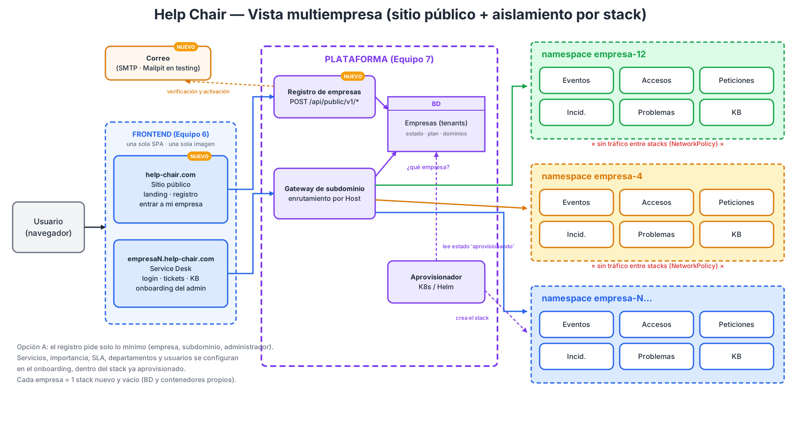
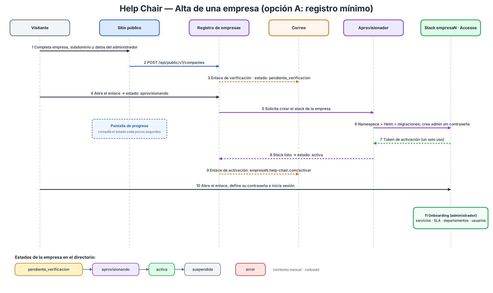

# Arquitectura / Architecture

*Español primero, English below.*

---

## 🇪🇸 Español

### 1. Componentes

| Componente | Alcance | Dueño | Descripción |
|---|---|---|---|
| Frontend | Global | Equipo 6 | **Una sola SPA y una sola imagen** con dos conjuntos de rutas según el dominio: **sitio público** (`help-chair.com`: landing, registro de empresa, entrar a mi empresa) y **Service Desk** (`empresaN.help-chair.com`). React + Vite + TypeScript. |
| Gateway de subdominio | Global | Equipo 7 | Resuelve la empresa a partir del `Host` y enruta al stack correcto. Expone además la **API pública de registro** (`/api/public/v1`, contrato en `contracts/gateway/`). |
| BD de empresas | Global | Equipo 7 | Directorio de *tenants*: empresa, subdominio, **estado del alta**, **plan**, dominios de correo y metadatos básicos. No guarda contraseñas ni configuración del help desk. |
| Aprovisionador | Global | Equipo 7 | Crea el stack (namespace, Helm, migraciones) de cada empresa verificada y pide a Accesos el administrador inicial. |
| Correo (SMTP) | Global | Equipo 7 (infra) | Envía verificación y activación del alta. Mailpit en testing. |
| Gateway de Eventos | Por stack | Equipo 1 | Punto de entrada del stack; recibe, filtra, clasifica, prioriza y enruta eventos. |
| Accesos | Por stack | Equipo 2 | Usuarios, roles, autenticación, eventos de credenciales y **activación del administrador inicial**. |
| Peticiones | Por stack | Equipo 3 | Solicitudes estándar del catálogo. |
| Incidencias | Por stack | Equipo 4 | Fallas y degradaciones de servicio. |
| Problemas | Por stack | Equipo 5 | Causa raíz, patrones repetidos, errores conocidos. |
| Base de Conocimiento (KB) | Por stack | Equipo 5 | Soluciones y artículos; se consume por API (Eventos, Incidencias, Problemas). |
| Broker de mensajes | Por stack | Equipo 7 (infra) | Mensajería asíncrona entre servicios (propuesto: NATS). |

**Ubicación en el monorepo:** Frontend (sitio público + Service Desk) → `frontend/`; Gateway, registro y BD de empresas → `platform/gateway/`; Aprovisionador → `platform/deploy/`; Eventos, Accesos, Peticiones, Incidencias, Problemas y KB → `services/<nombre>/`.

### 2. Ciclo de vida de una empresa

1. **Descubrimiento:** el visitante entra a `help-chair.com` (sitio público: qué es el producto, quiénes somos) y elige **Registrar mi empresa**.
2. **Registro mínimo:** pide solo empresa, subdominio deseado, datos básicos (sector, tamaño, país: opcionales) y nombre y correo del administrador. El gateway crea la solicitud en estado `pendiente_verificacion` y envía un correo de verificación.
3. **Verificación:** al abrir el enlace, la solicitud pasa a `aprovisionando`. **El stack no se crea hasta verificar el correo** (protege el clúster de abusos).
4. **Aprovisionamiento:** el aprovisionador crea un namespace con todos los contenedores y BD vacías y pide a **Accesos (dentro del stack)** crear el administrador inicial **sin contraseña**. Accesos devuelve un token de activación de un solo uso. La empresa pasa a `activa`.
5. **Activación:** el administrador recibe el enlace `empresaN.help-chair.com/activar?token=…`, define su contraseña (dentro del stack) e inicia sesión. La contraseña nunca pasa por el directorio global.
6. **Onboarding:** al primer ingreso, el administrador completa el asistente: servicios y su importancia, prioridades, SLA, departamentos, roles y usuarios. Aquí se captura la información detallada de la empresa.
7. **Operación:** el stack procesa eventos, peticiones, incidentes y problemas. El administrador crea usuarios con rol, contraseña inicial y privilegios.
8. **Acceso posterior:** un usuario que llega a `help-chair.com` usa **Entrar a mi empresa**: escribe su correo (o su subdominio) y el gateway lo redirige a `empresaN.help-chair.com`. La **autenticación** la realiza siempre Accesos **dentro del stack** (el directorio global solo guarda el mapeo dominio de correo → empresa).

Estados de la empresa en el directorio: `pendiente_verificacion → aprovisionando → activa`; además `suspendida` y `error` (reintento manual según runbook).

Detalle de endpoints, seguridad y reglas: [`REGISTRO-EMPRESA.md`](REGISTRO-EMPRESA.md).

### 3. Dominios y rutas

| Host | Qué sirve | Enrutamiento |
|---|---|---|
| `help-chair.com` | Sitio público (frontend) y API pública de registro | `/` → frontend; `/api/public/v1/*` → registro del gateway |
| `empresaN.help-chair.com` | Service Desk de la empresa | `/` → frontend; `/api/*` → stack de la empresa (resuelto por `Host`) |
| Reservados | `www`, `api`, `admin`, `app`, `mail`, `status`… | No se pueden registrar como subdominio |

- El frontend decide qué conjunto de rutas cargar leyendo `window.location.hostname` y un `/config.json` generado al arrancar el contenedor (variable `BASE_DOMAIN`), así **una misma imagen sirve a todos los ambientes y empresas**.
- El cliente de API usa **rutas relativas** (`/api/...`): no hay URL de API incrustada en el bundle y no hay CORS.

### 4. Aislamiento

- Un **namespace de Kubernetes por empresa**.
- **NetworkPolicy** que bloquea todo tráfico entre namespaces; solo el gateway global y el aprovisionador pueden entrar a cada stack.
- Secretos y credenciales de BD **por stack**. El aprovisionador usa un secreto por stack (`PROVISIONER_TOKEN`) para llamar a Accesos.
- Ningún servicio de un stack conoce direcciones de otro stack.

### 5. Comunicación interna

- **Síncrona (REST):** consultas puntuales (p. ej. Eventos → KB para auto-respuesta; Aprovisionador → Accesos para el administrador inicial).
- **Asíncrona (broker):** propagación de eventos (p. ej. Eventos → Incidencias; Accesos → Eventos; Incidencias → Problemas).
- Todos los endpoints y mensajes se definen en `contracts/` y se versionan con SemVer.
- Dirección de dependencias: **Eventos → (Peticiones, Incidencias, Problemas)**; **Accesos → Eventos**; **Problemas consume Incidencias** (no al revés); **KB es consultada** por Eventos, Incidencias y Problemas; **Frontend → Gateway (público) y → stack (Service Desk)**; **Plataforma → Accesos** (solo el alta del administrador inicial).

### 6. Flujo de un evento (resumen de las 9 reglas del equipo de Eventos)

| # | Condición | Destino |
|---|---|---|
| 1 | Evento de sistema, informativo, sin acción requerida | Solo registro (cierre automático) |
| 2 | Disparado por usuario, existe solución en KB, dificultad fácil | Auto-respuesta + encuesta (si no resuelve, sigue) |
| 3 | Advertencia bajo el umbral de recurrencia | Registro y vigilancia; alerta si supera el umbral |
| 4 | Seguridad o credenciales | Accesos / Seguridad |
| 5 | Solicitud estándar del catálogo | Peticiones |
| 6 | Falla, degradación o interrupción | Incidencias |
| 7 | Patrón repetido N veces en T días, o causa raíz desconocida | Problemas |
| 8 | Requiere modificar configuración/infraestructura | Cambios (absorbido por Peticiones en el MVP) |
| 9 | Ninguna coincide | Triage manual |

Estados de ciclo de vida: Nuevo → Asignado → En proceso ⇄ En espera → Resuelto → Cerrado; además Rechazado, Cancelado y Reabierto.

### 7. Responsabilidad de configuración (propuesta, por confirmar)

| Configuración | Dueño |
|---|---|
| Usuarios, roles, perfiles, departamentos, grupos | Accesos |
| Administrador inicial, token de activación y estado del onboarding (`onboarding_completed`) | Accesos |
| Catálogo de servicios, importancia, matriz de prioridad, SLA | Eventos (expone por API) |
| Metadatos de la empresa (nombre, subdominio, estado, plan, dominios de correo) | Plataforma |
| Registro público (verificación, límites de uso, nombres reservados) | Plataforma |
| Formularios de registro, activación y onboarding | Frontend (consume las APIs anteriores) |

### 8. Optimización de recursos

- Imágenes mínimas (Alpine / distroless / multi-stage).
- `requests`/`limits` de CPU y RAM por contenedor y `ResourceQuota` por namespace.
- Cupo máximo de empresas activas (`MAX_TENANTS`) para proteger el clúster de registros masivos.
- Escalado a cero / hibernación de stacks inactivos (p. ej. KEDA).
- Distribución ligera de Kubernetes (k3s) en desarrollo.
- Broker ligero (NATS) y pocos contenedores auxiliares.

---

## 🇬🇧 English

### 1. Components

| Component | Scope | Owner | Description |
|---|---|---|---|
| Frontend | Global | Team 6 | **One SPA and one image** with two route sets depending on the domain: **public site** (`help-chair.com`: landing, company sign-up, go to my company) and **Service Desk** (`companyN.help-chair.com`). React + Vite + TypeScript. |
| Subdomain gateway | Global | Team 7 | Resolves the company from the `Host` and routes to the right stack. Also exposes the **public sign-up API** (`/api/public/v1`, contract in `contracts/gateway/`). |
| Companies DB | Global | Team 7 | Tenant directory: company, subdomain, **sign-up status**, **plan**, email domains and basic metadata. Holds no passwords and no help desk configuration. |
| Provisioner | Global | Team 7 | Creates the stack (namespace, Helm, migrations) of each verified company and asks Access for the initial administrator. |
| Mail (SMTP) | Global | Team 7 (infra) | Sends sign-up verification and activation emails. Mailpit in testing. |
| Event Gateway | Per stack | Team 1 | Stack entry point; receives, filters, classifies, prioritises and routes events. |
| Access | Per stack | Team 2 | Users, roles, authentication, credential events and **initial administrator activation**. |
| Requests | Per stack | Team 3 | Standard catalogue requests. |
| Incidents | Per stack | Team 4 | Service failures and degradations. |
| Problems | Per stack | Team 5 | Root cause, recurring patterns, known errors. |
| Knowledge Base (KB) | Per stack | Team 5 | Solutions and articles; consumed via API (Events, Incidents, Problems). |
| Message broker | Per stack | Team 7 (infra) | Asynchronous messaging between services (proposed: NATS). |

**Location in the monorepo:** Frontend (public site + Service Desk) → `frontend/`; Gateway, sign-up and Companies DB → `platform/gateway/`; Provisioner → `platform/deploy/`; Events, Access, Requests, Incidents, Problems and KB → `services/<name>/`.

### 2. Company lifecycle (option A: minimal sign-up)

1. **Discovery:** the visitor lands on `help-chair.com` (public site: what the product is, who we are) and chooses **Register my company**.
2. **Minimal sign-up:** only company name, desired subdomain, basic data (sector, size, country: optional) and the administrator's name and email. The gateway creates the request as `pendiente_verificacion` and sends a verification email.
3. **Verification:** opening the link moves the request to `aprovisionando`. **The stack is not created until the email is verified** (protects the cluster from abuse).
4. **Provisioning:** the provisioner creates a namespace with all containers and empty DBs and asks **Access (inside the stack)** to create the initial administrator **without a password**. Access returns a single-use activation token. The company becomes `activa`.
5. **Activation:** the administrator receives `companyN.help-chair.com/activar?token=…`, sets a password (inside the stack) and logs in. The password never goes through the global directory.
6. **Onboarding:** on first login the administrator completes the wizard: services and their importance, priorities, SLAs, departments, roles and users. This is where detailed company information is captured.
7. **Operation:** the stack processes events, requests, incidents and problems. The administrator creates users with role, initial password and privileges.
8. **Later access:** a user arriving at `help-chair.com` uses **Go to my company**: enters their email (or subdomain) and the gateway redirects to `companyN.help-chair.com`. **Authentication** is always performed by Access **inside the stack** (the global directory only stores email domain → company mapping).

Company states in the directory: `pendiente_verificacion → aprovisionando → activa`; plus `suspendida` and `error` (manual retry per runbook).

Endpoint details, security and rules: [`REGISTRO-EMPRESA.md`](REGISTRO-EMPRESA.md) (Spanish).

### 3. Domains and routes

| Host | Serves | Routing |
|---|---|---|
| `help-chair.com` | Public site (frontend) and public sign-up API | `/` → frontend; `/api/public/v1/*` → gateway sign-up |
| `companyN.help-chair.com` | The company's Service Desk | `/` → frontend; `/api/*` → company stack (resolved by `Host`) |
| Reserved | `www`, `api`, `admin`, `app`, `mail`, `status`… | Cannot be registered as a subdomain |

- The frontend decides which route set to load from `window.location.hostname` and a `/config.json` generated at container start (`BASE_DOMAIN` variable), so **one image serves every environment and company**.
- The API client uses **relative paths** (`/api/...`): no API URL is baked into the bundle and no CORS is needed.

### 4. Isolation

- One **Kubernetes namespace per company**.
- **NetworkPolicy** blocking all cross-namespace traffic; only the global gateway and the provisioner may enter each stack.
- Database secrets and credentials **per stack**. The provisioner uses a per-stack secret (`PROVISIONER_TOKEN`) to call Access.
- No service in a stack knows another stack's addresses.

### 5. Internal communication

- **Synchronous (REST):** point queries (e.g. Events → KB for auto-reply; Provisioner → Access for the initial administrator).
- **Asynchronous (broker):** event propagation (e.g. Events → Incidents; Access → Events; Incidents → Problems).
- All endpoints and messages live in `contracts/`, versioned with SemVer.
- Dependency direction: **Events → (Requests, Incidents, Problems)**; **Access → Events**; **Problems consumes Incidents** (not the reverse); **KB is queried** by Events, Incidents and Problems; **Frontend → Gateway (public) and → stack (Service Desk)**; **Platform → Access** (initial administrator creation only).

### 6. Event flow (summary of Team 1's 9 rules)

| # | Condition | Destination |
|---|---|---|
| 1 | System event, informational, no action required | Log only (auto-close) |
| 2 | User-triggered, solution exists in KB, easy difficulty | Auto-reply + survey (if unresolved, continue) |
| 3 | Warning under recurrence threshold | Log & watch; alert if threshold exceeded |
| 4 | Security or credentials | Access / Security |
| 5 | Standard catalogue request | Requests |
| 6 | Failure, degradation or outage | Incidents |
| 7 | Same pattern N times in T days, or unknown root cause | Problems |
| 8 | Requires configuration/infrastructure change | Changes (absorbed by Requests in the MVP) |
| 9 | None match | Manual triage |

Lifecycle states: New → Assigned → In progress ⇄ On hold → Resolved → Closed; plus Rejected, Cancelled and Reopened.

### 7. Configuration ownership (proposal, to be confirmed)

| Configuration | Owner |
|---|---|
| Users, roles, profiles, departments, groups | Access |
| Initial administrator, activation token and onboarding state (`onboarding_completed`) | Access |
| Service catalogue, importance, priority matrix, SLAs | Events (exposed via API) |
| Company metadata (name, subdomain, status, plan, email domains) | Platform |
| Public sign-up (verification, rate limits, reserved names) | Platform |
| Sign-up, activation and onboarding forms | Frontend (consumes the APIs above) |

### 8. Resource optimisation

- Minimal images (Alpine / distroless / multi-stage).
- CPU/RAM `requests`/`limits` per container and a `ResourceQuota` per namespace.
- Maximum number of active companies (`MAX_TENANTS`) to protect the cluster from mass sign-ups.
- Scale-to-zero / hibernating idle stacks (e.g. KEDA).
- Lightweight Kubernetes (k3s) for development.
- Lightweight broker (NATS) and few auxiliary containers.
