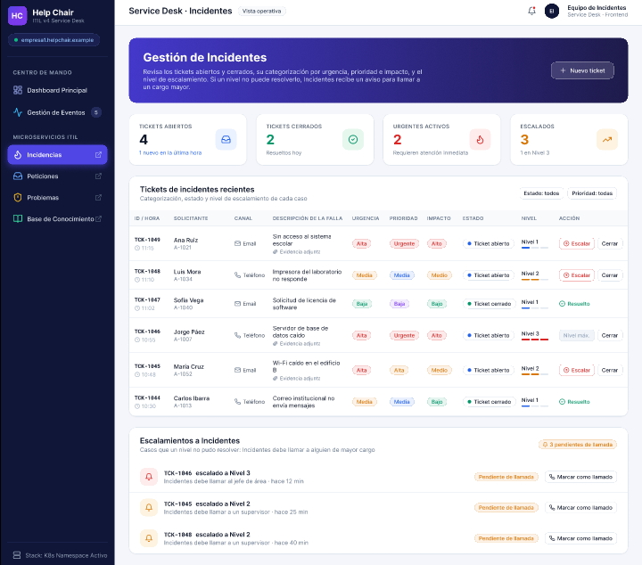
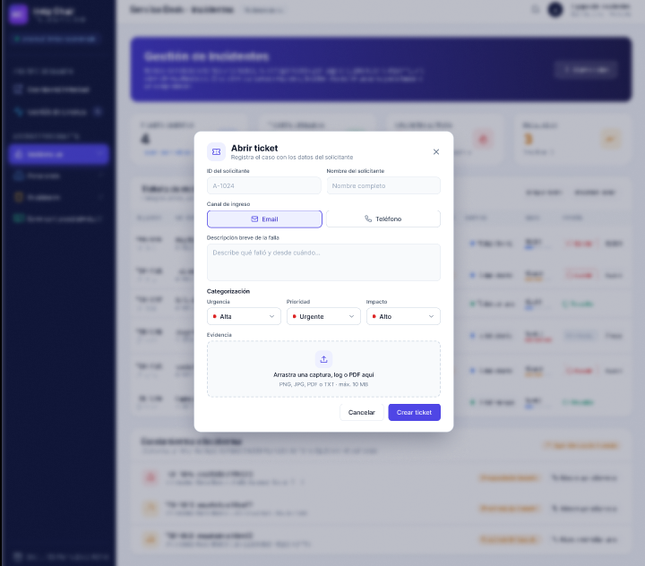

# Gestión de Incidentes · Diseño en Figma

Evidencias de diseño del módulo de incidencias del Service Desk (práctica ITIL v4 _Incident Management_, equipo 4). Capturas de Figma agregadas el 17 de noviembre de 2026.

| Captura                                                                  | Pantalla                   |
| ------------------------------------------------------------------------ | -------------------------- |
| [`incidentes-vista-general.png`](incidentes-vista-general.png)           | Vista principal del módulo |
| [`incidentes-modal-abrir-ticket.png`](incidentes-modal-abrir-ticket.png) | Modal «Abrir ticket»       |

## Cambios respecto al código actual

Hoy [`IncidentsPage.tsx`](../../src/features/incidents/IncidentsPage.tsx) solo muestra el marcador «Módulo de Incidencias Reservado». El diseño define el contenido del módulo:

| Área              | Antes (marcador actual)                                                 | Diseño en Figma                                                                                        |
| ----------------- | ----------------------------------------------------------------------- | ------------------------------------------------------------------------------------------------------ |
| Encabezado        | Tarjeta blanca con el título y la etiqueta «Equipo 4 · En construcción» | Banner con degradado índigo, título «Gestión de Incidentes», texto de ayuda y botón **+ Nuevo ticket** |
| Indicadores       | —                                                                       | 4 tarjetas: abiertos, cerrados, urgentes activos y escalados                                           |
| Lista de casos    | Tablero Kanban previsto en `DESIGN.md`, sin implementar                 | Tabla de tickets recientes con filtros por estado y prioridad                                          |
| Prioridad         | Calculada con impacto × urgencia (según el marcador y `DESIGN.md`)      | Urgencia, prioridad e impacto se eligen por separado                                                   |
| Escalamiento      | —                                                                       | Nivel 1 a 3 en cada ticket y lista de escalamientos pendientes de llamada                              |
| Registro de casos | —                                                                       | Modal «Abrir ticket» con canal de ingreso y evidencia adjunta                                          |

## 1. Vista principal

### Indicadores

| Tarjeta          | Valor de ejemplo | Texto de apoyo               |
| ---------------- | ---------------- | ---------------------------- |
| Tickets abiertos | 4                | 1 nuevo en la última hora    |
| Tickets cerrados | 2                | Resueltos hoy                |
| Urgentes activos | 2                | Requieren atención inmediata |
| Escalados        | 3                | 1 en Nivel 3                 |

### Tabla «Tickets de incidentes recientes»

- **Filtros:** «Estado: todos» y «Prioridad: todas».
- **Columnas:** ID y hora, solicitante (nombre e ID), canal (Email o Teléfono), descripción de la falla (con la marca «Evidencia adjunta» si trae archivo), urgencia, prioridad, impacto, estado, nivel y acción.
- **Colores de las etiquetas:**

  | Campo     | Rojo    | Ámbar | Azul  | Morado | Verde |
  | --------- | ------- | ----- | ----- | ------ | ----- |
  | Urgencia  | Alta    | Media | —     | —      | Baja  |
  | Prioridad | Urgente | Alta  | Media | Baja   | —     |
  | Impacto   | Alto    | Medio | —     | —      | Bajo  |

- **Estado:** «Ticket abierto» o «Ticket cerrado».
- **Nivel:** indicador de 1 a 3 barras.
- **Acciones:** un ticket abierto muestra **Escalar** y **Cerrar**. En Nivel 3, «Escalar» cambia a «Nivel máx.» (deshabilitado). Un ticket cerrado muestra «Resuelto».

### Escalamientos a Incidentes

Casos que un nivel no pudo resolver, con el contador «N pendientes de llamada». Cada caso indica a quién debe llamar Incidentes (Nivel 2: un supervisor; Nivel 3: el jefe de área), hace cuánto se escaló, la etiqueta «Pendiente de llamada» y el botón **Marcar como llamado**.

## 2. Modal «Abrir ticket»

Se abre con **+ Nuevo ticket**. Subtítulo: «Registra el caso con los datos del solicitante».

| Campo                         | Control                                        | Ejemplo                              |
| ----------------------------- | ---------------------------------------------- | ------------------------------------ |
| ID del solicitante            | Texto                                          | `A-1024`                             |
| Nombre del solicitante        | Texto                                          | Nombre completo                      |
| Canal de ingreso              | Dos opciones con icono                         | Email · Teléfono                     |
| Descripción breve de la falla | Área de texto                                  | «Describe qué falló y desde cuándo…» |
| Urgencia, prioridad e impacto | Listas desplegables (sección «Categorización») | Alta · Urgente · Alto                |
| Evidencia                     | Zona para arrastrar archivos                   | PNG, JPG, PDF o TXT, máx. 10 MB      |

Botones: **Cancelar** y **Crear ticket**.

## 3. Notas para implementar

Según [`AGENTS.md`](../../AGENTS.md) y la skill de diseño (`.agents/skills/help-chair-design/SKILL.md`):

- **Cascarón común:** el menú lateral y el encabezado de las capturas son `src/components/layout/ServiceDeskLayout.tsx`; `IncidentsPage` solo implementa el contenido. Lo que cambia ahí en Figma (título «Service Desk · Incidentes», etiqueta «Vista operativa», iconos de enlace externo, usuario «Equipo de Incidentes» y el azul del menú, `#101638` en Figma frente a `bg-slate-900` en el código) afecta a todos los módulos y se acuerda aparte.
- **Dominio:** la píldora de la empresa muestra `window.location.host`; `empresa1.helpchair.example` es solo texto de ejemplo.
- **Componentes existentes:** `Button`, `Badge`, `Card` y `Field`, `Input`, `Select`, `Textarea` de `@/components/ui/`.
- **Componentes por crear primero en `src/components/ui/`:** modal, selector de dos opciones (Email/Teléfono), zona para arrastrar archivos e indicador de nivel.
- **Datos:** mientras no exista `contracts/incidents/openapi.yaml`, los datos de ejemplo van en `features/incidents/data.ts` y los tipos en `features/incidents/types.ts`.
