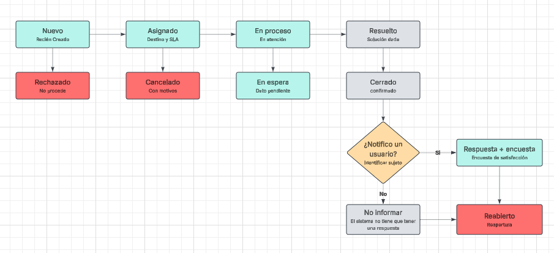
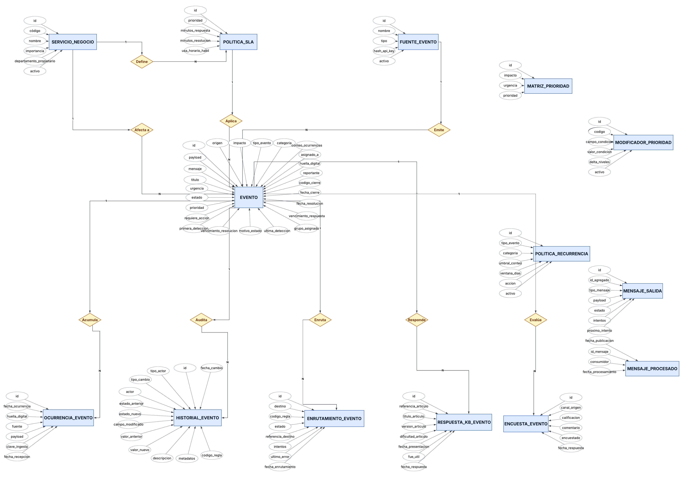
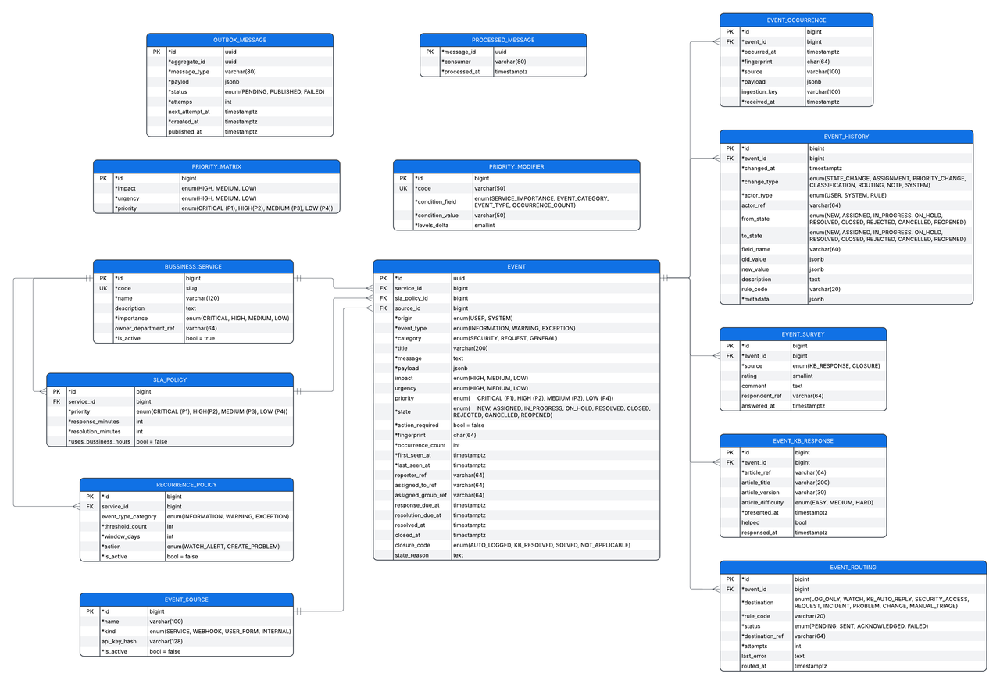

# Modelo de datos — Servicio de Eventos

## 1. Convenciones

| Tema | Decisión |
|---|---|
| Identificadores | `Event.id` es **UUID** (se comparte con otros servicios y viaja en los mensajes); el resto usa `bigint` autoincremental |
| Referencias a otros servicios | Campos `*_ref` (texto o UUID), **sin llave foránea**: cada servicio tiene su BD. Ejemplos: usuario (Accesos), artículo (KB), destino (Peticiones, Incidencias, Problemas) |
| Base de Conocimiento | Es de otro servicio (equipo de Problemas). Eventos la consulta **solo por API**; guarda `article_ref` y una instantánea (título, versión, dificultad) |
| Enumeraciones | `TextChoices` de Django guardados como texto (legibles en SQL); no se usan tipos `ENUM` de PostgreSQL |
| Fechas | `timestamptz` en UTC (`USE_TZ = True`) |
| Huella de auditoría | Todas las tablas de configuración y estado heredan `AuditModel`: `created_at`, `updated_at`, `created_by_ref`, `updated_by_ref` |
| Huella de deduplicación | `fingerprint` (SHA-256 en hexadecimal, 64 caracteres) en `event` y `event_occurrence` |
| Series de tiempo | Solo `event_occurrence` es *hypertable* de TimescaleDB |

## 2. Ciclo de vida de un evento

## 3. Diagrama entidad-relación

## 4. Diagrama de tablas

Las transiciones permitidas se definen **en código** (un diccionario `ALLOWED_TRANSITIONS`), no en una tabla. Un evento de usuario cerrado recibe encuesta; uno cancelado recibe los motivos; uno de sistema no recibe respuesta.

## 5. Enumeraciones

| Enum | Valores |
|---|---|
| `EventOrigin` | `USER`, `SYSTEM` |
| `EventType` (ITIL) | `INFORMATION`, `WARNING`, `EXCEPTION` |
| `EventCategory` | `SECURITY`, `REQUEST`, `GENERAL` |
| `EventState` | `NEW`, `ASSIGNED`, `IN_PROGRESS`, `ON_HOLD`, `RESOLVED`, `CLOSED`, `REJECTED`, `CANCELLED`, `REOPENED` |
| `Impact` / `Urgency` | `HIGH`, `MEDIUM`, `LOW` |
| `Priority` | `CRITICAL` (P1), `HIGH` (P2), `MEDIUM` (P3), `LOW` (P4) |
| `ServiceImportance` | `CRITICAL`, `HIGH`, `MEDIUM`, `LOW` |
| `Difficulty` | `EASY`, `MEDIUM`, `HARD` |
| `Destination` | `LOG_ONLY`, `WATCH`, `KB_AUTO_REPLY`, `SECURITY_ACCESS`, `REQUEST`, `INCIDENT`, `PROBLEM`, `CHANGE`, `MANUAL_TRIAGE` |
| `RoutingStatus` | `PENDING`, `SENT`, `ACKNOWLEDGED`, `FAILED` |
| `ClosureCode` | `AUTO_LOGGED`, `KB_RESOLVED`, `SOLVED`, `NOT_APPLICABLE` |
| `ChangeType` | `STATE_CHANGE`, `ASSIGNMENT`, `PRIORITY_CHANGE`, `CLASSIFICATION`, `ROUTING`, `NOTE`, `SYSTEM` |
| `ActorType` | `USER`, `SYSTEM`, `RULE` |
| `SurveySource` | `KB_RESPONSE`, `CLOSURE` |
| `OutboxStatus` | `PENDING`, `PUBLISHED`, `FAILED` |
| `RecurrenceAction` | `WATCH_ALERT`, `CREATE_PROBLEM` |
| `SourceKind` | `SERVICE`, `WEBHOOK`, `USER_FORM`, `INTERNAL` |

## 6. Diccionario de datos

### `business_service` (antes `ImportanceService`)
Servicio de TI del catálogo de la empresa, con su importancia (definida en el onboarding).

| Campo | Tipo | Nulo | Notas |
|---|---|---|---|
| id | bigint PK | no | |
| code | slug | no | único |
| name | varchar(120) | no | |
| description | text | sí | |
| importance | enum | no | usada como modificador de prioridad |
| owner_department_ref | varchar(64) | sí | departamento (vive en Accesos) |
| is_active | bool | no | por defecto `true` |
| huella de auditoría | | | `created_at`, `updated_at`, `created_by_ref`, `updated_by_ref` |

### `sla_policy`
Tiempos objetivo por prioridad; `service` nulo = política por defecto de la empresa.

| Campo | Tipo | Nulo | Notas |
|---|---|---|---|
| id | bigint PK | no | |
| service_id | FK `business_service` | sí | |
| priority | enum | no | |
| response_minutes | int | no | |
| resolution_minutes | int | no | |
| uses_business_hours | bool | no | `false` = 24×7 (versión mínima) |
| auditoría | | | |

Restricción: único (`service`, `priority`). Para `service` nulo, agregar una restricción única parcial sobre `priority`.

### `priority_matrix` (antes `MatrixPriority`)
Prioridad base a partir de impacto × urgencia.

| Campo | Tipo | Nulo | Notas |
|---|---|---|---|
| id | bigint PK | no | |
| impact | enum | no | |
| urgency | enum | no | |
| priority | enum | no | |
| auditoría | | | |

Restricción: único (`impact`, `urgency`). Siembra de 9 filas con `make seed`.

### `priority_modifier`
«Modificadores» del cálculo de prioridad (diagrama 2).

| Campo | Tipo | Nulo | Notas |
|---|---|---|---|
| id | bigint PK | no | |
| code | varchar(50) | no | único |
| condition_field | enum | no | `SERVICE_IMPORTANCE`, `EVENT_CATEGORY`, `EVENT_TYPE`, `OCCURRENCE_COUNT` |
| condition_value | varchar(50) | no | por ejemplo `CRITICAL` o `10` |
| levels_delta | smallint | no | `+1` sube un nivel, `-1` baja uno |
| is_active | bool | no | |
| auditoría | | | |

### `recurrence_policy`
Umbral y ventana T para las reglas 3 y 7 (advertencia bajo el umbral y patrón repetido).

| Campo | Tipo | Nulo | Notas |
|---|---|---|---|
| id | bigint PK | no | |
| event_type, category | enum | sí | nulo = aplica a cualquiera |
| service_id | FK `business_service` | sí | |
| threshold_count | int | no | N |
| window_days | int | no | T |
| action | enum | no | `WATCH_ALERT` o `CREATE_PROBLEM` |
| is_active | bool | no | |
| auditoría | | | |

### `event_source` (fase 4)
Fuentes registradas, para la ingesta por webhook con clave de API.

| Campo | Tipo | Nulo | Notas |
|---|---|---|---|
| id | bigint PK | no | |
| name | varchar(100) | no | único |
| kind | enum | no | |
| api_key_hash | varchar(128) | sí | se guarda solo el hash |
| is_active | bool | no | |
| auditoría | | | |

### `event` (estado actual, un registro por evento deduplicado)

| Campo | Tipo | Nulo | Notas |
|---|---|---|---|
| id | uuid PK | no | |
| origin | enum | no | usuario o sistema |
| event_type | enum | no | informativo, advertencia, excepción |
| category | enum | no | seguridad, petición, general |
| title / message | varchar(200) / text | no | |
| payload | jsonb | no | datos crudos |
| service_id | FK `business_service` | sí | |
| source_id | FK `event_source` | sí | |
| impact / urgency | enum | sí | entradas de la matriz |
| priority | enum | sí | calculada |
| state | enum | no | por defecto `NEW` |
| action_required | bool | no | `false` = informativo sin acción |
| fingerprint | char(64) | no | huella de deduplicación |
| occurrence_count | int | no | contador, inicia en 1 |
| first_seen_at / last_seen_at | timestamptz | no | |
| reporter_ref | varchar(64) | sí | sujeto a notificar |
| assigned_to_ref / assigned_group_ref | varchar(64) | sí | |
| sla_policy_id | FK `sla_policy` | sí | |
| response_due_at / resolution_due_at | timestamptz | sí | |
| resolved_at | timestamptz | sí | |
| **closed_at** | timestamptz | sí | es `fecha_cierre`, **nula al registrar** |
| closure_code | enum | sí | |
| state_reason | text | sí | motivo de rechazo o cancelación |
| auditoría | | | |

Índices y restricciones:
- **Único parcial** sobre `fingerprint` donde `state` no es `CLOSED`, `REJECTED` ni `CANCELLED` (un solo evento abierto por huella).
- (`state`), (`state`, `priority`), (`service_id`, `state`), (`assigned_to_ref`, `state`), (`created_at` descendente) y (`resolution_due_at`) donde el evento está abierto.

### `event_occurrence` (hypertable de TimescaleDB)
Cada llegada cruda de un evento. Permite calcular `n_eventos_similares` en una ventana T, analizar tendencias y aplicar retención.

| Campo | Tipo | Nulo | Notas |
|---|---|---|---|
| id | bigint | no | parte de la llave primaria |
| occurred_at | timestamptz | no | parte de la llave primaria y **columna de partición** |
| event_id | FK `event` | no | `PROTECT` |
| fingerprint | char(64) | no | |
| source | varchar(100) | no | |
| payload | jsonb | no | |
| ingestion_key | varchar(100) | sí | idempotencia; único junto con `occurred_at` |
| received_at | timestamptz | no | |

Índices: (`fingerprint`, `occurred_at` descendente), (`event_id`, `occurred_at` descendente).

### `event_history` (antes `EventsHistory`)
Bitácora de cambios, solo de inserción.

| Campo | Tipo | Nulo | Notas |
|---|---|---|---|
| id | bigint PK | no | |
| event_id | FK `event` | no | |
| changed_at | timestamptz | no | |
| change_type | enum | no | |
| actor_type / actor_ref | enum / varchar(64) | no / sí | usuario, sistema o regla |
| from_state / to_state | enum | sí | |
| field_name | varchar(60) | sí | |
| old_value / new_value | jsonb | sí | |
| description | text | sí | |
| rule_code | varchar(20) | sí | por ejemplo `R6` |
| metadata | jsonb | no | |

### `event_routing`
Trazabilidad de la decisión de destino (reglas 1–9) y de su entrega.

| Campo | Tipo | Nulo | Notas |
|---|---|---|---|
| id | bigint PK | no | |
| event_id | FK `event` | no | |
| destination | enum | no | |
| rule_code | varchar(20) | no | regla aplicada |
| status | enum | no | |
| destination_ref | varchar(64) | sí | ID en el servicio destino |
| attempts | int | no | |
| last_error | text | sí | |
| routed_at | timestamptz | sí | |
| auditoría | | | |

### `event_kb_response`
Auto-respuesta con artículo de la KB (regla 2) y su resultado. Eventos **no** guarda artículos: consulta la API del servicio de KB y solo registra qué mostró y si ayudó.

| Campo | Tipo | Nulo | Notas |
|---|---|---|---|
| id | bigint PK | no | |
| event_id | FK `event` | no | |
| article_ref | varchar(64) | no | ID del artículo (vive en la BD de la KB; **sin llave foránea**) |
| article_title | varchar(200) | sí | instantánea al momento de mostrarlo |
| article_version | varchar(30) | sí | versión del artículo mostrado |
| article_difficulty | enum | sí | la dificultad la define la KB; Eventos solo la copia (regla 2) |
| presented_at | timestamptz | no | |
| helped | bool | sí | nulo = sin respuesta; `false` = «no me sirvió» |
| responded_at | timestamptz | sí | |
| auditoría | | | |

### `event_survey`
Encuesta de satisfacción (tras la auto-respuesta o al cerrar).

| Campo | Tipo | Nulo | Notas |
|---|---|---|---|
| id | bigint PK | no | |
| event_id | FK `event` | no | |
| source | enum | no | |
| rating | smallint | sí | 1 a 5 |
| comment | text | sí | |
| respondent_ref | varchar(64) | sí | |
| answered_at | timestamptz | sí | |
| auditoría | | | |

### `outbox_message`
Patrón *outbox*: el mensaje se guarda en la misma transacción que el evento y se publica después.

| Campo | Tipo | Nulo | Notas |
|---|---|---|---|
| id | uuid PK | no | también es el `message_id` del sobre |
| aggregate_id | uuid | no | el `event.id` |
| message_type | varchar(80) | no | |
| payload | jsonb | no | conforme a `contracts/messages/` |
| status | enum | no | |
| attempts | int | no | |
| next_attempt_at | timestamptz | sí | |
| created_at / published_at | timestamptz | no / sí | |

### `processed_message`
Idempotencia del consumidor (evita procesar dos veces un mensaje, por ejemplo los eventos de login de Accesos).

| Campo | Tipo | Nulo | Notas |
|---|---|---|---|
| message_id | uuid PK | no | |
| consumer | varchar(80) | no | |
| processed_at | timestamptz | no | |

## 7. Qué entra en cada fase

| Fase | Tablas |
|---|---|
| 1 | `business_service`, `sla_policy`, `priority_matrix`, `event`, `event_history` |
| 2 | `event_occurrence` (hypertable), `recurrence_policy`, `priority_modifier`, `outbox_message` |
| 3 | `event_routing`, `event_kb_response`, `event_survey`, `processed_message` |
| 4 | `event_source` y, si hace falta, `event_notification` |
