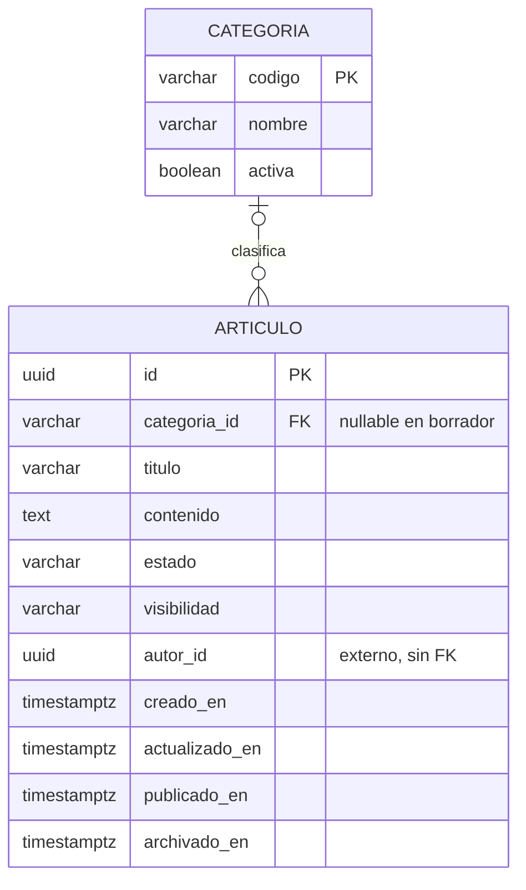

# Esquema inicial de artículos — #109 / #132

Este incremento incorpora artículos con UUID, categorías locales, restricciones
SQL, migración PostgreSQL y admin. La revisión del equipo y consumidores sigue pendiente.
Una sola implementación
cubre el dominio compartido de #109/#132; no cierra ni duplica #133.

PostgreSQL 16 es el motor adoptado por ROADMAP. Django 5.2 y DRF usan las
dependencias ya fijadas; no hay nueva dependencia. KB tiene su propia BD:
API 8006, PostgreSQL del host 5446 → 5432, hostname Compose `knowledge-db`.
El esquema no demuestra por sí solo conformidad exhaustiva o certificación ITIL 4.

## Modelos y contrato previsto

| Modelo/campo | Tipo / obligatoriedad | Regla o correspondencia prevista para #134/#112 |
|---|---|---|
| Categoria.codigo | varchar(50), PK | Código estable minúsculo: `^[a-z][a-z0-9_]{0,49}$`; no enum fijo |
| Categoria.nombre | varchar(100), no NULL | Nombre con un carácter no blanco |
| Categoria.activa | boolean, true inicial | Clasificación local, no catálogo externo de Eventos |
| Categoria.creado_en/actualizado_en | timestamptz | UTC; actualización no anterior a creación |
| Articulo.id | UUID, PK, uuid4 | `string/uuid`, readOnly; cabe en la referencia textual de Problemas (máx. 64) |
| titulo | varchar(200), vacío permitido en borrador | No hay unicidad de título |
| contenido | text, vacío permitido en borrador | Cuerpo canónico Markdown; no se duplica en arrays de pasos |
| categoria | FK local nullable, PROTECT | Código de categoría en DTO; NULL permitido en borrador |
| estado | varchar(12), `borrador` inicial | `borrador`, `publicado`, `archivado` |
| visibilidad | varchar(16), `soporte` inicial | `empresa` o `soporte`; empresa significa autenticados del stack, no internet |
| autor_id | UUID externo nullable | Sujeto de Accesos, sin FK; no es el usuario staff local |
| creado_en | timestamptz, default al instanciar | No editable; se conoce antes de guardar para validar fechas |
| actualizado_en | timestamptz, auto_now | Se actualiza al guardar; QuerySet.update debe gestionarlo expresamente |
| publicado_en | timestamptz nullable | Última publicación; conservar al archivar/retirar |
| archivado_en | timestamptz nullable | Presente exactamente cuando estado=archivado |



El primer estado permite un borrador incompleto. Publicar exige título/contenido
no blancos, categoría existente, autor y fecha de publicación. Son CHECK SQL,
además de validación de modelo/admin. Se comprueba el orden de las fechas:
creación ≤ actualización/publicación/archivo y publicación ≤ archivo si existen.
La expresión regular PostgreSQL `\s` cubre la clase de espacios; las pruebas
incluyen espacios, tabuladores, saltos de línea y `codigo="red\n"` por ORM directo.

El índice compuesto `(estado, visibilidad, actualizado_en DESC, id)` prepara
consulta ordenada; no implementa búsqueda ni autorización. Las otras garantías
son PK, FK local, checks y NOT NULL. La categoría referenciada no se borra
(PROTECT). Su código es de solo lectura en admin tras crearla.

`full_clean()` comprueba además categoría activa al publicar y devuelve errores
por campo. `save()`/`QuerySet.update()` no ejecutan esa validación automáticamente.
Un CHECK no valida otra tabla, autenticación o transiciones. La publicación
concurrente y la desactivación de categoría requieren los comandos atómicos del
incremento posterior; aquí solo se demuestra el esquema. No se consulta Accesos
ni otra BD para validar un UUID externo.

El admin registra ambos modelos, filtra estado/audiencia/categoría y permite
demostrar datos válidos e inválidos. No sustituye permisos/JWT de negocio.
`autor_id` se introduce como referencia externa: nunca se copia `request.user.pk`.
Una vez asignado, el autor es de solo lectura. El alta exige un borrador;
al editarlo y elegir publicado/archivado el formulario asigna las fechas del
servidor. Estas fechas son de solo lectura, no valores enviados por el cliente.
No permite eliminar artículos, porque otros servicios podrían referenciarlos;
se conserva UUID/contenido/última publicación al archivarlos. No se implementa
todavía una máquina de transiciones, revisión, historial editorial o CRUD REST.

## Datos de ejemplo y verificación

`articles/fixtures/kb_demo.json` es la fuente canónica sintética para #111:
dos categorías y cuatro artículos (borrador, publicado empresa, publicado soporte,
archivado), con UUID fijos y un autor ficticio explícito. No crea usuarios ni
contraseñas. Recargar sobrescribe esos mismos ejemplos; usar solo en una BD de
ensayo, no para reemplazar datos reales. No se añade un segundo seed:
`make seed` queda para #111.

Desde `services/knowledge`, con Python 3.12 y dependencias del lock:

```bash
# Configurar antes SECRET_KEY y DATABASE_URL de una BD PostgreSQL propia de ensayo.
# make setup copia un .env.example todavía pendiente de corregir en #111.
uv run python manage.py migrate --plan
uv run python manage.py sqlmigrate articles 0001
make migrate
uv run python manage.py showmigrations articles
make migrate  # debe informar que no hay migraciones pendientes
uv run python manage.py makemigrations --check --dry-run
uv run python manage.py loaddata kb_demo
uv run python manage.py loaddata kb_demo  # conserva 2 categorías / 4 artículos
make lint
make test
```

Para la evidencia de PostgreSQL vacío se debe comprobar el motor y que no hay
tablas antes de la primera migración. SQLite no acredita ese criterio. La suite
comprueba borradores/publicados, restricciones mediante update/create sin
formularios, FK, PROTECT, archivo, límites, fixture repetible y formularios admin.
El readiness actual solo ejecuta SELECT 1: no demuestra migraciones aplicadas.

## Dependencias y alcance pendiente

`contracts/knowledge/openapi.yaml` sigue ausente: esta tabla es un mapping
propuesto, no una correspondencia revisada o aprobada. #134/#112 deben confirmar
tipos/nullabilidad, rutas, operaciones, errores y permisos con consumidores.
Los mocks frontend son provisionales: `KB-028`, `publico/agentes`, arrays de
síntomas/pasos y `error_conocido_id` no son el contrato aprobado.

Problemas conserva el vínculo autoritativo ErrorConocido.articulo_kb_id (texto
≤64); puede haber varios errores para un artículo. No se añade una relación
inversa maestra ni una FK entre servicios. Accesos identifica usuarios con UUID,
pero KB todavía no implementa validación JWT/empresa ni permisos editoriales.

#111 integra PostgreSQL/variables/arranque/seed; #135 coordina calidad y #136 el
README operativo. Este incremento aporta sus propias pruebas y documentación.
CRUD/publicación/búsqueda corresponden a fase II; uso/feedback a fase III.
Revisión avanzada, snapshots completos, adjuntos y aprobaciones multinivel no
pertenecen a esta migración. No cerrar #109 por disponer solo de esta rama:
faltan revisión del equipo/contrato y el flujo de publicación autorizado.
