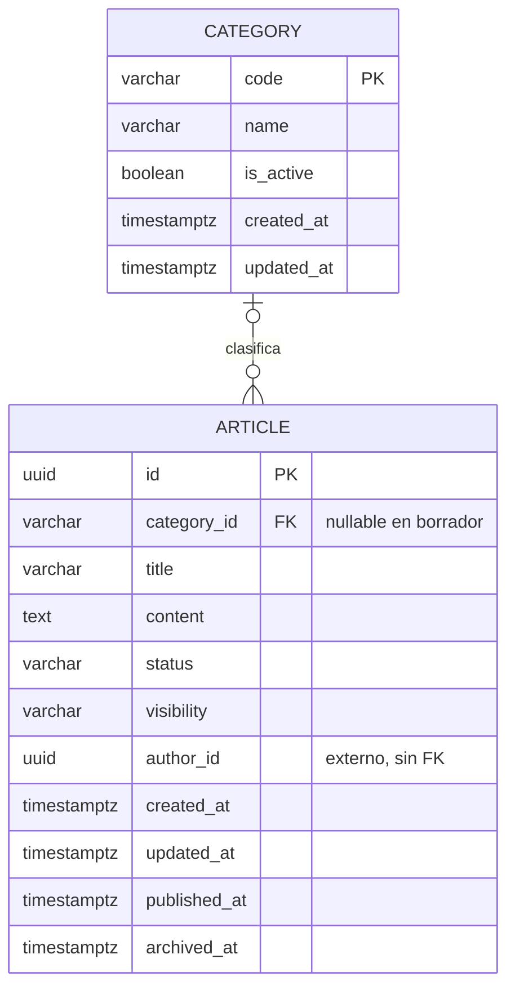

# Esquema inicial de artículos — #109 / #132

Este incremento incorpora artículos con UUID, categorías locales, restricciones
SQL, migración PostgreSQL y admin. La revisión del equipo y consumidores sigue pendiente.
Una sola implementación canónica en [PR #228](https://github.com/help-chair/help-chair/pull/228)
cubre el esquema compartido de #109/#132 y la misma necesidad expresada en #133:
artículo, migración inicial, admin y PostgreSQL propio. #133 no necesita un segundo
modelo o migración. Esta correspondencia no cierra ni reasigna ninguna issue y
no sustituye la revisión del equipo.

PostgreSQL 16 es el motor adoptado por ROADMAP. Django 5.2 y DRF usan las
dependencias ya fijadas; no hay nueva dependencia. KB tiene su propia BD:
API 8006, PostgreSQL del host 5446 → 5432, hostname Compose `knowledge-db`.
El esquema no demuestra por sí solo conformidad exhaustiva o certificación ITIL 4.

## Modelos y contrato previsto

| Modelo/campo | Tipo / obligatoriedad | Regla o correspondencia prevista para #134/#112 |
|---|---|---|
| Category.code (`codigo`) | varchar(50), PK | Código estable minúsculo: `^[a-z][a-z0-9_]{0,49}$`; no enum fijo |
| Category.name (`nombre`) | varchar(100), no NULL | Nombre con un carácter no blanco |
| Category.is_active (`activa`) | boolean, true inicial | Clasificación local, no catálogo externo de Eventos |
| Category.created_at/updated_at | timestamptz | UTC; actualización no anterior a creación |
| Article.id | UUID, PK, uuid4 | `string/uuid`, readOnly; cabe en la referencia textual de Problemas (máx. 64) |
| title (`titulo`) | varchar(200), vacío permitido en borrador | No hay unicidad de título |
| content (`contenido`) | text, vacío permitido en borrador | Cuerpo canónico Markdown; no se duplica en arrays de pasos |
| category (`categoria`) | FK local nullable, PROTECT | Código de categoría en DTO; NULL permitido en borrador |
| status (`estado`) | varchar(12), `borrador` inicial | `borrador`, `publicado`, `archivado` |
| visibility (`visibilidad`) | varchar(16), `soporte` inicial | `empresa` o `soporte`; empresa significa autenticados del stack, no internet |
| author_id (`autor_id`) | UUID externo nullable | Sujeto de Accesos, sin FK; no es el usuario staff local |
| created_at (`creado_en`) | timestamptz, default al instanciar | No editable; se conoce antes de guardar para validar fechas |
| updated_at (`actualizado_en`) | timestamptz, auto_now | Se actualiza al guardar; QuerySet.update debe gestionarlo expresamente |
| published_at (`publicado_en`) | timestamptz nullable | Última publicación; conservar al archivar/retirar |
| archived_at (`archivado_en`) | timestamptz nullable | Presente exactamente cuando status=`archivado` |



El primer estado permite un borrador incompleto. Publicar exige título/contenido
no blancos, categoría existente, autor y fecha de publicación. Son CHECK SQL,
además de validación de modelo/admin. Se comprueba el orden de las fechas:
creación ≤ actualización/publicación/archivo y publicación ≤ archivo si existen.
La expresión regular PostgreSQL `\s` cubre la clase de espacios; las pruebas
incluyen espacios, tabuladores, saltos de línea y `code="red\n"` por ORM directo.

El índice compuesto `kb_article_query_idx` `(status, visibility, updated_at DESC, id)` prepara
consulta ordenada; no implementa búsqueda ni autorización. Las otras garantías
son PK, FK local, checks y NOT NULL. La categoría referenciada no se borra
(PROTECT). Su código es de solo lectura en admin tras crearla.

`full_clean()` comprueba además categoría activa al publicar y devuelve errores
por campo. `save()`/`QuerySet.update()` no ejecutan esa validación automáticamente.
Un CHECK no valida otra tabla, autenticación o transiciones. La publicación
concurrente y la desactivación de categoría requieren los comandos atómicos del
incremento posterior; aquí solo se demuestra el esquema. No se consulta Accesos
ni otra BD para validar un UUID externo.

El admin registra ambos modelos, filtra estado/audiencia/categoría y permite
demostrar datos válidos e inválidos. No sustituye permisos/JWT de negocio.
`author_id` se introduce como referencia externa: nunca se copia `request.user.pk`.
Una vez asignado, el autor es de solo lectura. El alta exige un borrador;
al editarlo y elegir publicado/archivado el formulario asigna las fechas del
servidor. Estas fechas son de solo lectura, no valores enviados por el cliente.
No permite eliminar artículos, porque otros servicios podrían referenciarlos;
se conserva UUID/contenido/última publicación al archivarlos. No se implementa
todavía una máquina de transiciones, revisión, historial editorial o CRUD REST.

## Identificadores en inglés (migración 0002)

El código usa identificadores en inglés (estándar del proyecto); la API pública conserva
los nombres del contrato en español y los serializers los mapean con `source=`. Las
`verbose_name`, etiquetas de choices y mensajes de validación siguen en español, y los
valores guardados no cambian (`borrador`, `publicado`, `archivado`, `empresa`, `soporte`).

| Antes | Ahora |
|---|---|
| `Categoria` (`articles_categoria`) | `Category` (`articles_category`) |
| `codigo`, `nombre`, `activa` | `code`, `name`, `is_active` |
| `Articulo` (`articles_articulo`) | `Article` (`articles_article`) |
| `titulo`, `contenido`, `categoria` (`categoria_id`) | `title`, `content`, `category` (`category_id`) |
| `estado`, `visibilidad`, `autor_id` | `status`, `visibility`, `author_id` |
| `creado_en`, `actualizado_en`, `publicado_en`, `archivado_en` | `created_at`, `updated_at`, `published_at`, `archived_at` |
| `Articulo.Estado`: `BORRADOR`, `PUBLICADO`, `ARCHIVADO` | `Article.Status`: `DRAFT`, `PUBLISHED`, `ARCHIVED` |
| `Articulo.Visibilidad`: `EMPRESA`, `SOPORTE` | `Article.Visibility`: `COMPANY`, `SUPPORT` |
| `related_name="articulos"` | `related_name="articles"` |
| `kb_categoria_codigo_valido`, `kb_categoria_nombre_no_blanco`, `kb_categoria_fechas_validas` | `kb_category_code_valid`, `kb_category_name_not_blank`, `kb_category_dates_valid` |
| `kb_articulo_estado_valido`, `kb_articulo_visibilidad_valida` | `kb_article_status_valid`, `kb_article_visibility_valid` |
| `kb_articulo_publicacion_completa`, `kb_articulo_archivo_consistente`, `kb_articulo_fechas_validas` | `kb_article_publication_complete`, `kb_article_archive_consistent`, `kb_article_dates_valid` |
| índice `kb_articulo_consulta_idx` | índice `kb_article_query_idx` |

`0002_english_identifiers` solo emite renombres en SQL (`ALTER TABLE ... RENAME`,
`RENAME CONSTRAINT`, `ALTER INDEX ... RENAME`): no borra ni recrea tablas, columnas,
restricciones o índices. PostgreSQL actualiza las columnas renombradas dentro de cada
CHECK e índice; Django no lo hace en su estado, por eso cada restricción usa
`SeparateDatabaseAndState` (renombre en la BD, condición nueva en el estado). El resto
de la migración (`verbose_name` en español, `ordering`) son metadatos sin SQL. Los nombres
autogenerados de PK, FK e índices de la FK conservan su nombre anterior; Django los
localiza por introspección, no por nombre. `0001_initial` no se modifica.

Los permisos de auth no se renombran: en una BD migrada desde `0001` quedan huérfanos los
anteriores (`add_articulo`, `view_categoria`...) junto a los nuevos (`add_article`,
`view_category`...) que crea `post_migrate`. No afecta a superusuarios y hoy ningún usuario
staff tiene permisos específicos; si hiciera falta, se pueden limpiar después desde el admin
o el shell de Django.

La fixture `kb_demo.json` usa los nombres nuevos de modelo y campo con los mismos PK y
valores. El validador del contrato compara contra la fixture fijada al commit `4f8573d`
mediante `git show`, por lo que no depende de esta versión.

## Correspondencia documental con el contrato publicado para revisión

Fuentes fijadas: [modelos 4f8573d](https://github.com/help-chair/help-chair/blob/4f8573d442de3c01a4f866d5468f3f4ac6e2d4ec/services/knowledge/articles/models.py),
[migración 4f8573d](https://github.com/help-chair/help-chair/blob/4f8573d442de3c01a4f866d5468f3f4ac6e2d4ec/services/knowledge/articles/migrations/0001_initial.py)
y [OpenAPI 8666c03, PR #230](https://github.com/help-chair/help-chair/blob/8666c03416c7862e470efaf5c7a273ec32c30087/contracts/knowledge/openapi.yaml).
El contrato ya está integrado por #230 en develop. Los enlaces fijados
conservan la fuente del contraste; integración no equivale a implementación
de su API ni a aceptación de cada decisión por todos los consumidores.

| Modelo o garantía | Correspondencia en OpenAPI v0 | Límite del contraste |
|---|---|---|
| Article.id, UUID estable | ArticuloBase.id y parámetro ArticuloId: string/uuid; lectura readOnly | Compatible con referencia textual externa; no crea FK entre servicios |
| Category.code, PK local de hasta 50 caracteres | CodigoCategoria y campo categoria como código, no objeto ni ID de Eventos | Patrón con final absoluto; catálogo dinámico, sin enum fijo |
| category nullable con FK local/PROTECT | Campo requerido en lectura pero nullable en borrador/archivado; no null en ArticuloPublicado | El esquema JSON no demuestra existencia, actividad o PROTECT en BD |
| title hasta 200, content Markdown; borrador incompleto | ArticuloCrear/Actualizar y ArticuloBase permiten texto vacío; Publicado exige carácter no blanco | No hay título único, resumen obligatorio ni arrays de pasos duplicados |
| status borrador/publicado/archivado | oneOf ArticuloBorrador/Publicado/Archivado; estado de lectura readOnly | Crear no acepta estado; PATCH no lo acepta; transiciones siguen fuera del runtime entregado |
| visibility empresa/soporte independiente de status | Enum compartido en escritura/lectura; empresa significa autenticados del stack | No acredita autorización o delegación entre servicios |
| author_id UUID externo nullable | Nullable en lectura general; obligatorio no null en Publicado; no aceptado en escritura | La API futura lo deriva de sub validado; no del usuario staff local |
| created_at/updated_at no null | date-time readOnly, campos requeridos en lectura | UTC y orden temporal se verifican por reglas/modelo, no solo por formato JSON |
| published_at nullable y obligatorio si publicado | ArticuloPublicado lo exige no null; otros estados conservan posibilidad de null o última publicación | No inventa publicación histórica de un borrador o archivado |
| archived_at exactamente cuando archivado | No null en ArticuloArchivado; null en Borrador/Publicado | La unicidad de estado y los CHECK se prueban también en PostgreSQL |
| Publicación completa y fechas coherentes | Variante Publicado restringe campos; descripción conserva reglas de fechas | Categoría activa se valida en full_clean/admin; no hay CHECK entre tablas ni servicio de transición implementado |
| Datos canónicos | Cuatro ejemplos de lectura reproducen kb_demo.json de 4f8573d | Son datos sintéticos de dominio; Creado/Editado son proyecciones previstas de API |

Problemas conserva el vínculo autoritativo articulo_kb_id de texto hasta 64
caracteres, compatible con el UUID canónico de KB. Varios errores pueden apuntar
al mismo artículo. No se añade error_conocido_id inverso ni copia de identidades.
La validación contractual ya registrada comprueba cuatro proyecciones de fixture;
ni esa validación ni Prism demuestran reglas de BD, JWT, ranking o integración.

Las cinco operaciones de negocio del PR #230 son previstas. Las rutas health
sí existen, pero SELECT 1 no demuestra migraciones aplicadas. Conservar las
decisiones abiertas de permisos, prefijo, errores, paginación y aplicabilidad;
no convertir este contraste en un acuerdo aprobado.

## Datos de ejemplo y verificación

`articles/fixtures/kb_demo.json` es la fuente canónica sintética para #111:
dos categorías y cuatro artículos (borrador, publicado empresa, publicado soporte,
archivado), con UUID fijos y un autor ficticio explícito. No crea usuarios ni
contraseñas. Recargar sobrescribe esos mismos ejemplos; usar solo en una BD de
ensayo, no para reemplazar datos reales. `make seed CONFIRM_DEMO=1` reutiliza esta
fixture con advertencia de recarga; sin opt-in no carga datos.

Desde `services/knowledge`, con Python 3.12 y dependencias del lock:

```bash
# Configurar antes SECRET_KEY, DATABASE_URL y ALLOWED_HOSTS de una BD PostgreSQL propia de ensayo.
# make setup instala dependencias; el sistema suministra las variables privadas.
# .env.example solo documenta nombres vacíos y no se copia ni se carga.
uv run --frozen python manage.py migrate --plan
uv run --frozen python manage.py sqlmigrate articles 0001
uv run --frozen python manage.py sqlmigrate articles 0002  # solo renombres
make migrate
uv run --frozen python manage.py showmigrations articles
make migrate  # debe informar que no hay migraciones pendientes
uv run --frozen python manage.py makemigrations --check --dry-run
make seed CONFIRM_DEMO=1
make seed CONFIRM_DEMO=1  # conserva 2 categorías / 4 artículos de demo
make lint
make test
```

Para la evidencia de PostgreSQL vacío se debe comprobar el motor y que no hay
tablas antes de la primera migración. SQLite no acredita ese criterio. La suite
comprueba borradores/publicados, restricciones mediante update/create sin
formularios, FK, PROTECT, archivo, límites, fixture repetible y formularios admin.
El readiness actual solo ejecuta SELECT 1: no demuestra migraciones aplicadas.

## Dependencias y alcance pendiente

El contrato previsto `contracts/knowledge/openapi.yaml` se entrega en el incremento
separado #134/#112 y ya está integrado por #230 en develop. Esta tabla es un mapping
propuesto, no una correspondencia aprobada: deben confirmarse tipos, nulabilidad,
rutas, operaciones, errores y permisos con consumidores.
Los mocks frontend son provisionales: `KB-028`, `publico/agentes`, arrays de
síntomas/pasos y `error_conocido_id` no son el contrato aprobado.

Problemas conserva el vínculo autoritativo ErrorConocido.articulo_kb_id (texto
≤64); puede haber varios errores para un artículo. No se añade una relación
inversa maestra ni una FK entre servicios. Accesos identifica usuarios con UUID,
pero KB todavía no implementa validación JWT/empresa ni permisos editoriales.

#111 integra PostgreSQL/variables/arranque/seed, pruebas operativas y README.
Este incremento del esquema aporta sus propias pruebas y documentación.
CRUD/publicación/búsqueda corresponden a fase II; uso/feedback a fase III.
Revisión avanzada, snapshots completos, adjuntos y aprobaciones multinivel no
pertenecen a esta migración. Los modelos de #228 ya están integrados; esta resolución conserva sus blobs.
El cierre y los acuerdos de consumidores se comprueban por su flujo propio,
sin atribuirlos automáticamente a la integración técnica.
