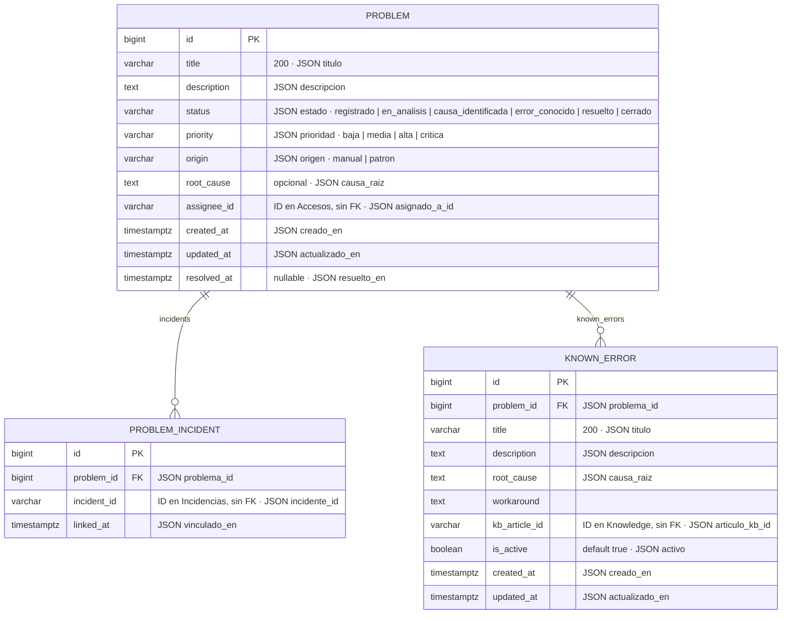

# Problems

[English below](#english)

## Español

Servicio del equipo 5 para problemas, incidentes vinculados y errores conocidos.
El esquema, migración inicial y admin ya integrados de #13 se conservan. Django
admin usa autenticación local de Django; no constituye integración JWT de negocio.
Los modelos no importan código ni consultan bases de otros servicios. Sus claves
internas son bigint; las referencias externas son texto de hasta 64 caracteres.
El CRUD de problemas y su cambio de estado (#271), el vínculo con incidentes (#272)
y la API de errores conocidos (#273) están implementados; el detector N/T y la
autorización de negocio siguen pendientes. No se emiten tokens de Accesos.

Requisitos: Linux/WSL, Python 3.12, uv, Make, PostgreSQL 16 y Podman para la imagen.
El Dockerfile produce una imagen OCI; no requiere Docker Desktop.

### Modelo de datos

Los identificadores del código (modelos, campos, tablas) están en inglés desde la
migración `0002_english_identifiers`; los `verbose_name` del admin y las etiquetas de
las opciones siguen en español. **El JSON del contrato conserva los nombres en
español**: los serializers mapean cada campo con `source=` (por ejemplo `titulo` →
`title`, `causa_raiz` → `root_cause`, `incidente_id` → `incident_id`), y los valores
de los enums (`registrado`, `en_analisis`…) no cambian.

Los IDs de otros servicios (`assignee_id`, `incident_id`, `kb_article_id`) se guardan como texto, **sin llaves foráneas**: cada servicio es dueño de su propia base de datos.



Tablas: `problems_problem`, `problems_problemincident` y `problems_knownerror`.
`PROBLEM_INCIDENT` tiene la restricción única `problem_incident_unique`
`(problem_id, incident_id)`: un incidente no puede vincularse dos veces al mismo problema.
La `0002` solo renombra tablas y columnas (`RenameModel`/`RenameField`), así que conserva
los datos; la restricción única se quita y se vuelve a crear con su nombre nuevo en la
misma transacción. La clave primaria y el índice de la FK conservan en PostgreSQL los
nombres que les dio la `0001`; Django no depende de esos nombres.

### Responsabilidad y rutas operativas

Se conservan los aportes compatibles de #205: Problems registra causas y errores
conocidos, vincula incidentes por ID y mantiene workarounds; Incidencias conserva
la atención de incidentes y Knowledge conserva los artículos. El origen patron es
un dato del modelo, no evidencia de un detector implementado. La autenticación del
admin es local Django; la identidad de negocio corresponde a Accesos.

| Método | Ruta existente | Uso |
|---|---|---|
| GET | /health/live | Proceso disponible |
| GET | /health/ready | Conexión a BD comprobada |
| GET | /api/schema/ | Esquema parcial del runtime |
| GET | /api/docs/ | Swagger del runtime |
| GET, POST | /api/problems/v1/problemas/ | Lista paginada (filtros `estado`, `prioridad`, `origen`) y alta |
| GET, PATCH | /api/problems/v1/problemas/{id}/ | Consulta y actualización parcial (sin PUT ni DELETE) |
| POST | /api/problems/v1/problemas/{id}/estado/ | Cambio de estado según `problems/states.py` |
| GET, POST | /api/problems/v1/problemas/{id}/incidentes/ | Lista (arreglo sin paginar) y vínculo de incidentes |
| DELETE | /api/problems/v1/problemas/{id}/incidentes/{incidente_id}/ | Desvincula un incidente |
| GET, POST | /api/problems/v1/errores-conocidos/ | Lista paginada (filtro `activo`, búsqueda `q`) y alta |
| GET, PATCH | /api/problems/v1/errores-conocidos/{id}/ | Consulta y actualización parcial (sin PUT ni DELETE) |

### API de problemas (#271, #272, #273)

- **Autenticación pendiente (Fase 3).** La API todavía **no valida el JWT de Accesos**
  que exige el contrato: hoy cualquier solicitud está permitida. La autenticación y
  los permisos están en un solo lugar, `REST_FRAMEWORK` de `config/settings.py`
  (`DEFAULT_AUTHENTICATION_CLASSES` vacío y `DEFAULT_PERMISSION_CLASSES` = `AllowAny`,
  marcado `TODO Fase 3: validar JWT de Accesos`). No exponer el servicio fuera de
  entornos de desarrollo/ensayo hasta completar esa fase.
- **Transiciones.** La tabla de transiciones permitidas (`ALLOWED_TRANSITIONS`) y los
  estados que exigen `causa_raiz` viven solo en `problems/states.py`. Una transición no
  permitida (o al mismo estado) responde 409 `transicion_invalida`.
- **Errores.** `core/errors.py` (`handle_exception`) da a todas las vistas DRF el
  formato `{codigo, detalle, campos}`; `campos` mapea cada campo a su primer mensaje.
  `core/schemas.py` documenta ese formato (`ErrorSerializer`) en `/api/docs/`.
- **Paginación y filtros reutilizables.** `core/pagination.py` (`page`, `page_size`
  20 por defecto, máximo 100; página fuera de rango → 404) y `core/filters.py`
  (`filter_by_choices` contra los `TextChoices` del modelo, `filter_by_boolean` solo
  acepta `true`/`false` y `search_text` busca sin distinguir mayúsculas; un valor
  inválido → 400).
- **Nombres.** Los identificadores del código van en inglés, incluidos modelos y
  campos; rutas, campos JSON, parámetros de consulta, valores de los enums y de
  `codigo`, `operationId` y mensajes al usuario siguen el contrato en español. El
  mapeo JSON → modelo está en `PROBLEM_JSON_FIELDS` y `KNOWN_ERROR_JSON_FIELDS`
  (`problems/serializers.py`) y el de filtros en `LIST_FILTERS` y
  `KNOWN_ERROR_BOOLEAN_FILTERS` (`problems/views.py`).
- **Incidentes vinculados (#272).** El incidente se guarda solo por su ID de texto
  (1–64 caracteres): no se consulta ni valida contra Incidencias y no hay llave
  foránea entre servicios. La restricción única `(problem_id, incident_id)` se
  traduce en 409 `incidente_ya_vinculado`; el mismo incidente sí puede vincularse a
  problemas distintos. Desvincular un incidente no vinculado a ese problema da 404.
- **Errores conocidos (#273).** El listado va del más reciente al más antiguo; `activo`
  filtra con `true`/`false` y `q` busca en título, descripción, causa raíz y
  workaround sin distinguir mayúsculas (un `q` vacío no filtra). En el alta,
  `problema_id` inexistente responde **400** (no 404), como pide el contrato, y
  `articulo_kb_id` se guarda como texto sin consultar Knowledge. En PATCH un error
  conocido no cambia de problema: `problema_id`, `id` y las fechas se ignoran, y si el
  cuerpo no trae ningún campo modificable responde 400 (`minProperties: 1`).
- **Pruebas.** `tests/factories.py` (factory_boy) ofrece `ProblemFactory`, coherente
  con el estado, `ProblemIncidentFactory` y `KnownErrorFactory`.

La política confirmada por Pablo exige PostgreSQL y entorno real incluso en local
/tests; las indicaciones anteriores de #205 sobre .env/defaults/SQLite se sustituyen
por las instrucciones de esta guía. La aceptación del equipo sigue pendiente.

### Configuración del entorno del proceso

El sistema/CI suministra las variables antes del arranque. No se crea, copia ni
carga .env. .env.example contiene únicamente nombres vacíos para documentación;
no es una configuración ejecutable. Ausencia de secretos obligatorios impide
arrancar con un error que identifica solo el nombre de la variable. No hay clave
predeterminada, bypass por DEBUG/pytest ni SQLite implícito.

| Variable | Obligatoria | Finalidad / formato |
|---|---|---|
| SECRET_KEY | Sí | Clave privada Django, no vacía, gestionada fuera de Git |
| DATABASE_URL | Sí | URI PostgreSQL con usuario, contraseña, host y BD |
| ALLOWED_HOSTS | Sí | Lista de hosts separados por comas |
| DEBUG | No | Booleano; ejecución normal sin depuración |
| SERVICE_NAME | No | Identidad del servicio en los logs |
| LOG_LEVEL | No | Nivel Python admitido |
| PORT | No | Puerto TCP positivo de gunicorn |
| WEB_CONCURRENCY | No | Cantidad positiva de workers |
| GRACEFUL_TIMEOUT | No | Segundos positivos para completar peticiones al parar |
| DATABASE_CONNECT_TIMEOUT | No | Segundos positivos de espera de conexión PostgreSQL |

Compose requiere además POSTGRES_USER, POSTGRES_PASSWORD y POSTGRES_DB privados y
coherentes con DATABASE_URL. PROBLEMS_IMAGE selecciona imagen local;
PROBLEMS_API_PORT y PROBLEMS_DB_PORT permiten puertos de ensayo aislados.
PROBLEMS_STOP_GRACE_PERIOD debe superar GRACEFUL_TIMEOUT con margen para apagar.
No escribir secretos en YAML, argumentos, builds, historial, evidencia o imágenes.
Se suministran mediante entorno privado/gestor de secretos; nunca en el chat.

### Ejecución y puertos

API: 8005. PostgreSQL: host 5445 → contenedor 5432. En host/WSL Django usa
localhost:5445; en la red Compose usa problems-db:5432. Son conexiones distintas.
No reutilizar la BD de Knowledge ni el volumen de otro servicio.

Desde services/problems, con el entorno privado ya suministrado y PostgreSQL propio
accesible, sin imprimir los valores:

```bash
make setup
make migrate
uv run --frozen python manage.py showmigrations problems
make migrate
uv run --frozen python manage.py migrate --check
uv run --frozen python manage.py makemigrations --check --dry-run
uv run --frozen python manage.py check
make run
```

Setup respeta el lock y no copia .env. La segunda migración no debe tener cambios
pendientes; no regenerar 0001_initial ni crear migraciones para reproducir #13.
El servidor de desarrollo también migra al arrancar. Su puerto se cambia mediante
la variable Make PORT; gunicorn usa el entorno. No ejecutar ambos en 8005 a la vez.
El admin se puede demostrar con un usuario staff de ensayo creado interactivamente,
sin versionar contraseñas ni usar su PK como identidad externa de Accesos.

### Seed y calidad

Solo en BD propia y desechable de ensayo, nunca en datos reales:

```bash
make seed CONFIRM_DEMO=1
make seed CONFIRM_DEMO=1
make lint
make test
make build CONTAINER=podman
```

El seed es exclusivo de Problems y usa el comando seed_demo; no crea artículos,
usuarios o entidades ajenas. Solo se activa con confirmación explícita y jamás
al construir, migrar o arrancar. Usa una transacción, controla concurrencia y
colisiones y no elimina filas ajenas. Una colisión incompatible aborta sin carga
parcial; no restaurar ejemplos editados silenciosamente. Sus pruebas verifican
repetición, vínculos, colisión y continuidad de las secuencias bigint.

Las pruebas necesitan PostgreSQL aislado y rol de ensayo con permiso para crear
la BD de test. Credenciales efímeras se generan privadamente fuera del repositorio
sin mostrarlas. Se conservan las pruebas del modelo de #13. No ejecutar make lock
si no cambian dependencias. Los hooks se limitan a archivos explícitos; no aplicar
normalización masiva del monorepo.

### Imagen y Compose exclusivo

El build reúne estáticos con settings separados sin SECRET_KEY o conexión a BD.
Runtime exige las variables reales; UID/GID 10001 ejecuta gunicorn como PID principal.
compose.yaml de esta carpeta contiene solo Problems, su PostgreSQL y una tarea
puntual de migración previa. El volumen problems-data pertenece al proyecto Compose.

```bash
: "${COMPOSE_PROVIDER:?COMPOSE_PROVIDER}" "${DOCKER_HOST:?DOCKER_HOST}"
"$COMPOSE_PROVIDER" --env-file /dev/null -f compose.yaml up --build -d
"$COMPOSE_PROVIDER" --env-file /dev/null -f compose.yaml stop problems
"$COMPOSE_PROVIDER" --env-file /dev/null -f compose.yaml start problems
```

COMPOSE_PROVIDER debe ser la ruta explícita al binario Docker Compose oficial
verificado por el operador; DOCKER_HOST apunta al socket privado de Podman.
No seleccionar podman-compose ni delegar al proveedor predeterminado. Algunos
proveedores expanden valores privados a argumentos de Podman. No volcar config,
inspect completo o entorno. --env-file /dev/null evita cargar .env implícitamente.
Docker Compose puede utilizar el socket privado de Podman sin Docker Desktop.
La API recibe DATABASE_URL de la red interna y el proveedor recibe entorno privado;
no colocar credenciales en opciones -e con valores literales. El Compose global de
Plataforma requiere un cambio independiente de configuración privada, no incluido
aquí; tampoco debe sustituir silenciosamente esta configuración de gunicorn.

### Salud, logs y recuperación

```bash
curl --fail http://localhost:8005/health/live
curl --fail http://localhost:8005/health/ready
```

Live verifica proceso. Ready ejecuta SELECT 1 y devuelve 503/database down si la BD
no responde. Después del arranque, detener solo la BD de ensayo debe mantener live
200, dar ready 503 y recuperar ready 200 al restaurar la BD sin reiniciar la API.
Un arranque frío esperando la migración es un caso distinto. Ready no demuestra
que las tablas estén migradas: verificar también problems.0001_initial, 0002 y consultas.
Los tiempos de conexión y DNS se acotan; medirlos en el entorno de ejecución.

Logs Django y gunicorn son JSON a stderr. Access registra método/estado/duración;
no URL, query, cabeceras, cuerpos o texto de excepciones. Make/migrate/seed tienen
salida operativa de consola. No publicar entornos, DSN ni volcados de datos.
El presupuesto de parada del motor debe superar graceful-timeout; verificar
SIGTERM, ausencia de SIGKILL/OOM y persistencia al reiniciar conservando el volumen.
No usar down -v, flush o borrado de recursos ajenos para demostrar persistencia.

### Contrato y límites de evidencia

El [contrato en develop](https://github.com/help-chair/help-chair/blob/develop/contracts/problems/openapi.yaml)
de #39/PR182 fue actualizado por el [PR223 integrado](https://github.com/help-chair/help-chair/pull/223):
el prefijo contractual es `/api/problems/v1`. El merge de develop incorpora ese contrato; la conciliación no modifica sus
definiciones ni implementa sus endpoints de negocio.
Conservar IDs int64, referencias externas de texto, estados y campos acordados.
Admin y health no acreditan CRUD/JWT implementados.

make openapi exige OPENAPI_OUTPUT fuera de contracts y rechaza sobrescribir el
contrato revisado. La exportación parcial de runtime no sustituye OpenAPI de negocio.
Tests de compatibilidad consultan los esquemas sin editar el YAML ni depender de
modelos de KB. El diagrama y migración heredados de #13 no se duplican.

Registrar las verificaciones propias de Problems: migraciones, seed, lint/test/build,
health normal/fallo/recuperación, UID/PID, logs, SIGTERM, persistencia y escaneo de
secretos en fuentes, evidencia, metadatos y capas. No atribuirle resultados de KB.
Un build local no prueba publicación de imagen, CI, despliegue o aprobación.
Seguir [CONTRIBUTING.md](../../CONTRIBUTING.md) y CODEOWNERS; no incorporar AGENTS o documentos personales.

La [trazabilidad de criterios y evidencia local](docs/foundations-evidence.md)
relaciona #110 y la parte de Problems de #135/#136 con archivos y resultados.

## English

Team 5 owns this independent Problems service and its PostgreSQL 16 database.
Python 3.12, Django/DRF, uv, Make and Linux/WSL are required; Podman builds/runs OCI
images without requiring Docker Desktop. The diagram above preserves the merged
#13 schema: bigint internal IDs, local relations and text external references.
Code identifiers (models, fields, tables) are English since migration 0002, which
only renames tables/columns and keeps the data; the contract JSON keeps its Spanish
names through serializer `source=` mappings, and enum values are unchanged. Local
admin authentication does not implement Access JWT or business authorization.
Problem CRUD and state transitions (#271), incident links by text ID (#272) and the
known errors API (#273: `activo` filter, case-insensitive `q` search, 400 for an
unknown `problema_id`, PATCH never moves it to another problem) are implemented;
the N/T detector belongs to a subsequent increment. The API
does **not** validate Access JWTs yet (Phase 3): authentication/permissions live
only in `REST_FRAMEWORK` in `config/settings.py` (`AllowAny`, marked TODO).

### Responsibility and operational routes

Compatible #205 contributions are retained: Problems records underlying causes,
incident references and known errors/workarounds; Incidents handles incidents,
Knowledge owns articles and Access owns business identities. The patron origin is
a model value, not an implemented detector. Existing GET routes are /health/live,
/health/ready, /api/schema/ and /api/docs/; schema/Swagger describe partial runtime.
Pablo confirmed PostgreSQL and process environment even for local/tests; this guide
supersedes #205 advice about .env/default secrets/SQLite, pending team acceptance.

### Process configuration

Supply configuration through the real process/container/CI environment before
startup. No .env file is created, copied or loaded. The empty .env.example only
lists names. Required SECRET_KEY, DATABASE_URL and ALLOWED_HOSTS must be nonempty;
DATABASE_URL must explicitly select PostgreSQL with user/password/host/database.
Failures report variable names only, with no default secret, DEBUG/pytest bypass
or implicit SQLite. Never supply secret values in Git, command history, chat,
Compose literals, build ARGs, logs, screenshots, evidence or image layers.

Optional DEBUG is boolean; SERVICE_NAME identifies the service; LOG_LEVEL is a
supported Python level. PORT is a valid positive TCP port; WEB_CONCURRENCY is a
positive worker count; GRACEFUL_TIMEOUT and DATABASE_CONNECT_TIMEOUT are positive
seconds. Compose also requires privately supplied POSTGRES_USER, POSTGRES_PASSWORD
and POSTGRES_DB matching DATABASE_URL. PROBLEMS_IMAGE selects the local image;
PROBLEMS_API_PORT/PROBLEMS_DB_PORT isolate test ports. PROBLEMS_STOP_GRACE_PERIOD
must remain longer than the gunicorn shutdown budget.

### Running, seed and quality

API port is 8005; PostgreSQL maps host5445 to internal5432. Host/WSL connects using
localhost:5445; containers use problems-db:5432. Never share Knowledge's DB or
volume. From services/problems with the private environment already supplied,
run the setup/migration/check/run commands shown above. Setup uses the existing
lock without configuring secrets. Repeating migrate must have nothing pending;
check existing problems.0001_initial/0002 rather than recreating #13. Development run
also migrates and uses Make PORT; gunicorn uses its environment. Avoid occupying
8005 with the development server and container simultaneously. Create any demo
staff user interactively, without publishing credentials or treating its local PK
as an external Access identity.

Only on a disposable isolated test DB, run the two confirmed seed calls and
lint/test/build commands shown above. The Problems-only seed_demo command creates
no KB articles, users or other-service entities. It requires explicit opt-in,
never runs automatically, uses a transaction and guards concurrent calls/ID
collisions. Incompatible existing rows cause an atomic abort; unrelated data is
preserved and modified examples are not silently restored. Tests cover repetition,
relations, collision rollback and bigint sequence continuity. Tests need their own
PostgreSQL role allowed to create the test DB and privately generated credentials.
Retain #13's model tests; do not regenerate locks unnecessarily or format the whole
monorepo. Run hooks on an explicit file list only.

### Containers and checks

Static collection during build uses separate settings with no key or DB. Runtime
still requires real configuration. UID/GID10001 runs gunicorn directly as PID1.
COMPOSE_PROVIDER must explicitly name the verified official Docker Compose binary,
with DOCKER_HOST pointing at a private Podman socket. Do not use podman-compose
or an implicit provider. The service-local Compose contains Problems, its DB and a one-shot migration
before the API. Its project owns problems-data. Use the up/stop/start commands
above, retaining --env-file /dev/null to suppress implicit .env loading. Use a
provider sending secrets through the engine's private API, not expanded process
arguments; Docker Compose can communicate with Podman without Docker Desktop.
Never print expanded config, full inspect, environments or DSNs. The global
Platform Compose needs a separate privacy/configuration contribution and is not
modified by this service change.

GET /health/live and /health/ready are operational endpoints. After startup,
stopping only the test DB must yield live200/ready503; restoring it must recover
ready200 without restarting the API. Cold startup waiting for migration is a
separate case. SELECT1 does not establish schema readiness: also inspect the
existing migration and query Problems tables. Connection and DNS waits are
bounded and must be measured. Django/gunicorn logs are JSON on stderr; access
contains method/status/duration without URL/query/headers/body or exception text.
Make/migrate/seed console output is operational. Verify SIGTERM with sufficient
engine stop time, no SIGKILL/OOM, and persistence across API/DB restart without
down -v, flush or deleting unrelated resources.

The [develop contract](https://github.com/help-chair/help-chair/blob/develop/contracts/problems/openapi.yaml)
from #39/PR182 was updated by [merged PR223](https://github.com/help-chair/help-chair/pull/223):
its contractual prefix is `/api/problems/v1`. The develop merge brings that contract into this branch; conflict resolution
does not modify its definitions or implement business endpoints. Preserve bigint IDs,
external text IDs and agreed enums/fields. This increment does not implement its
business API. make openapi requires explicit OPENAPI_OUTPUT outside contracts and
cannot replace the reviewed contract with a partial runtime schema. Compatibility
tests read schema definitions only, without editing YAML or importing KB models.
Record Problems-specific quality, DB, seed, image, health, logging, shutdown,
persistence and secret-scan results; Knowledge test counts are not Problems
acceptance evidence. Local build does not prove published images, CI, deployment
or consumer approval. Follow [CONTRIBUTING.md](../../CONTRIBUTING.md) and CODEOWNERS and exclude personal
AGENTS/context documents from product commits.

See the [criteria and local evidence mapping](docs/foundations-evidence.md) for #110
and the Problems portion of #135/#136, including remaining human reviews.
