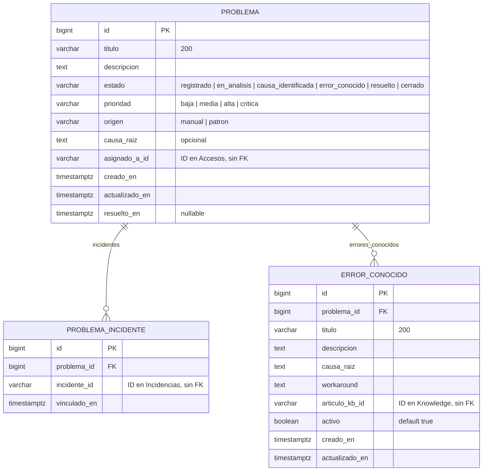

# services/problems

[English below ↓](#english)

> Gestión de Problemas: causa raíz, patrones repetidos y errores conocidos. / Problem Management: root cause, recurring patterns and known errors.

| | |
|---|---|
| **Equipo / Team** | Gestión de Problemas / Problem Management |
| **Práctica ITIL v4 / ITIL v4 practice** | Problem Management + Knowledge Management |
| **Imagen / Image** | `ghcr.io/help-chair/hc-problems` |
| **Contratos / Contracts** | `contracts/problems/` |
| **Puerto / Port** | `8005` (BD local en `5445`) |

## Español

### Responsabilidad

**Qué hace esta carpeta:**

- Registra los problemas, es decir, la causa de fondo detrás de uno o varios incidentes, con su estado (`registrado` → `en_analisis` → `causa_identificada` → `error_conocido` → `resuelto` → `cerrado`), su prioridad y su responsable.
- Vincula cada problema con los incidentes que lo originaron, guardando solo el ID del incidente.
- Documenta la causa raíz y mantiene la base de errores conocidos (KEDB): cada error conocido lleva su causa y su solución temporal (*workaround*) para que los agentes salgan del paso mientras se corrige el fondo.
- Abre problemas a mano o a partir de un patrón repetido que detecta Incidencias (origen `manual` o `patron`).

**Qué NO hace:**

- No atiende ni cierra incidentes: eso es de Incidencias. Problemas consume a Incidencias, no al revés.
- No guarda artículos de ayuda: viven en `services/knowledge`. Un error conocido solo guarda el ID de su artículo.
- No autentica usuarios ni guarda sus datos: eso es de Accesos. Aquí solo se guarda el ID del responsable.
- No lee la base de datos de ningún otro servicio ni expone la suya. Todo lo de fuera se guarda como ID de texto, sin llaves foráneas.

### Stack tecnológico
- Lenguaje / framework: Python / Django
- Base de datos: PostgreSQL (propia de este servicio)

### Modelo de datos
Los IDs de otros servicios (`asignado_a_id`, `incidente_id`, `articulo_kb_id`) se guardan como texto, **sin llaves foráneas**: cada servicio es dueño de su propia base de datos.



`PROBLEMA_INCIDENTE` tiene una restricción única `(problema_id, incidente_id)`: un incidente no puede vincularse dos veces al mismo problema.

### Contrato mínimo de servicio
- [ ] `Dockerfile` y usuario no root
- [ ] `GET /health/live` y `GET /health/ready`
- [ ] Configuración solo por variables de entorno (`.env.example`)
- [ ] Logs en JSON
- [ ] API documentada con OpenAPI en `contracts/`; eventos según `contracts/messages/`
- [ ] Imagen publicada en `ghcr.io/help-chair/hc-problems`
- [ ] `requests`/`limits` de recursos declarados
- [ ] Cierre ordenado con `SIGTERM`
- [ ] Workflow de CI propio, filtrado por esta ruta (ver `../../CONTRIBUTING.md`)

### Ejecución local

```bash
cd services/problems
make setup                   # crea .env y el entorno virtual
source .venv/bin/activate    # solo si no tienes uv (ver nota)
make test                    # pruebas con cobertura
make lint                    # ruff, sin modificar archivos
make run                     # migra y arranca en http://localhost:8005
```

> **Nota:** si tienes [uv](https://docs.astral.sh/uv/) instalado, `make` lo usa solo y no hace falta activar nada. Sin uv, el `make` que trae macOS (3.81) no encuentra los programas del entorno virtual, por eso hay que activarlo antes con `source .venv/bin/activate`.

Con eso corre sobre SQLite, suficiente para desarrollar y para `make test`. El servicio usa su **propia base PostgreSQL 16**; para trabajar contra ella, levántala con el compose y descomenta `DATABASE_URL` en tu `.env`:

```bash
podman compose -f ../../platform/deploy/local/compose.yaml up -d problems-db
make migrate && make run
```

Para levantar el stack completo (cada servicio con su base) desde la raíz del repo:

```bash
make up        # podman compose (o docker compose) con platform/deploy/local/compose.yaml
```

Comprobación rápida:

```bash
curl http://localhost:8005/health/ready
# {"status": "ok", "database": "up"}
```

### API

| Método | Ruta | Para qué |
|---|---|---|
| `GET` | `/health/live` | El proceso responde. |
| `GET` | `/health/ready` | El proceso responde y la base es alcanzable. |
| `GET` | `/api/schema/` | Contrato OpenAPI generado por `drf-spectacular`. |
| `GET` | `/api/docs/` | Documentación navegable (Swagger). |

Las rutas de problemas y errores conocidos se documentan en `contracts/problems/`. Para exportar el contrato después de cambiar la API:

```bash
make openapi
```

### Variables de entorno

Las define `.env.example`:

| Variable | Para qué | Por omisión |
|---|---|---|
| `SERVICE_NAME` | Nombre del servicio en los logs. | `problems` |
| `DEBUG` | Modo desarrollo. Sin `DEBUG=true` hay que definir `SECRET_KEY`. | `false` |
| `SECRET_KEY` | Clave de Django. Obligatoria fuera de desarrollo. | — |
| `ALLOWED_HOSTS` | Hosts permitidos. | `*` |
| `LOG_LEVEL` | Nivel de los logs (JSON). | `INFO` |
| `PORT` | Puerto del servidor en el contenedor. | `8005` |
| `DATABASE_URL` | Base PostgreSQL del servicio. Sin ella se usa SQLite. | — |
| `BROKER_URL` | Broker de mensajes (fase 2). | — |

### Reglas del monorepo
Trabaja **solo dentro de esta carpeta**. Si necesitas tocar otra, abre un PR separado o coordínate con sus dueños. Guía: [`CONTRIBUTING.md`](../../CONTRIBUTING.md).

---

## English

### Responsibility

**What this folder does:** records problems (the underlying cause behind one or more incidents) with their status, priority and owner; links each problem to the incidents that triggered it by incident ID; documents the root cause and keeps the known-error database (KEDB), where each known error has its cause and workaround; opens problems manually or from a recurring pattern detected by Incidents (`manual` or `patron` origin).

**What it does NOT do:** it does not handle or close incidents (Incidents does; Problems consumes Incidents, not the reverse); it does not store help articles (they live in `services/knowledge`, a known error only keeps the article ID); it does not authenticate users (Access does); it never reads another service's database nor exposes its own — everything external is stored as a text ID, without foreign keys.

### Tech stack
- Language / framework: Python 3.12 / Django 5 + Django REST Framework, OpenAPI via `drf-spectacular`
- Database: PostgreSQL 16 owned by this service (SQLite locally when `DATABASE_URL` is unset)

### Minimum service contract
See the checklist above.

### Running locally
```bash
cd services/problems
make setup                   # creates .env and the virtualenv
source .venv/bin/activate    # only if you don't have uv
make test && make lint
make run                     # http://localhost:8005
```

Without uv, macOS's bundled `make` (3.81) can't find the virtualenv's programs, so activate it first. To use the service's PostgreSQL, run `podman compose -f ../../platform/deploy/local/compose.yaml up -d problems-db` and uncomment `DATABASE_URL` in your `.env`. `make up` from the repo root starts the whole stack. See the Spanish section above for the endpoint and environment variable tables.

### Monorepo rules
Work **only inside this folder**. If you must change another one, open a separate PR or coordinate with its owners. Guide: [`CONTRIBUTING.en.md`](../../CONTRIBUTING.en.md).
