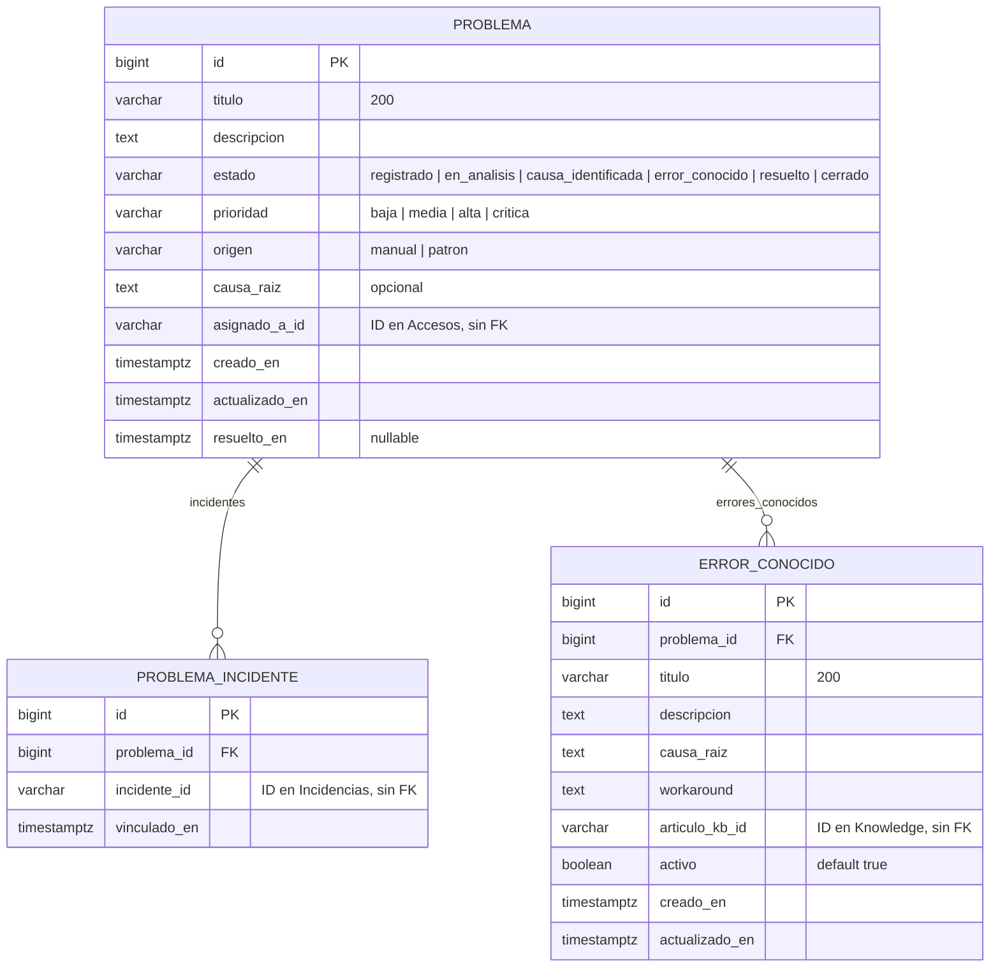

# services/problems

[English below ↓](#english)

> Gestión de Problemas: causa raíz, patrones repetidos y errores conocidos. / Problem Management: root cause, recurring patterns and known errors.

| | |
|---|---|
| **Equipo / Team** | Gestión de Problemas / Problem Management |
| **Práctica ITIL v4 / ITIL v4 practice** | Problem Management + Knowledge Management |
| **Imagen / Image** | `ghcr.io/help-chair/hc-problems` |
| **Contratos / Contracts** | `contracts/` |

## Español

### Responsabilidad
<!-- Qué hace esta carpeta y qué NO hace -->

### Stack tecnológico
- Lenguaje / framework: Python / Django
- Base de datos: PostgreSQL (propia de este servicio)

### Modelo de datos
Los IDs de otros servicios (`asignado_a_id`, `incidente_id`, `articulo_kb_id`) se guardan como texto, **sin llaves foráneas**: cada servicio es dueño de su propia base de datos.



`PROBLEMA_INCIDENTE` tiene una restricción única `(problema_id, incidente_id)`: un incidente no puede vincularse dos veces al mismo problema.

### Contrato mínimo de servicio
- [ ] `Dockerfile` y usuario no root
- [ ] `GET /health/live` y `GET /health/ready`
- [ ] Configuración solo por variables de entorno (`.env.example`)
- [ ] Logs en JSON
- [ ] API documentada con OpenAPI en `contracts/`; eventos según `contracts/messages/`
- [ ] Imagen publicada en `ghcr.io/help-chair/hc-problems`
- [ ] `requests`/`limits` de recursos declarados
- [ ] Cierre ordenado con `SIGTERM`
- [ ] Workflow de CI propio, filtrado por esta ruta (ver `../../CONTRIBUTING.md`)

### Ejecución local
```bash
cp .env.example .env
# TODO: comandos para levantar el servicio
```

### Reglas del monorepo
Trabaja **solo dentro de esta carpeta**. Si necesitas tocar otra, abre un PR separado o coordínate con sus dueños. Guía: [`CONTRIBUTING.md`](../../CONTRIBUTING.md).

---

## English

### Responsibility
<!-- What this folder does and does NOT do -->

### Tech stack
- Language / framework: _to be defined by the team_
- Database: _to be defined by the team_ (owned by this service)

### Minimum service contract
See the checklist above.

### Running locally
```bash
cp .env.example .env
# TODO: commands to start the service
```

### Monorepo rules
Work **only inside this folder**. If you must change another one, open a separate PR or coordinate with its owners. Guide: [`CONTRIBUTING.en.md`](../../CONTRIBUTING.en.md).
